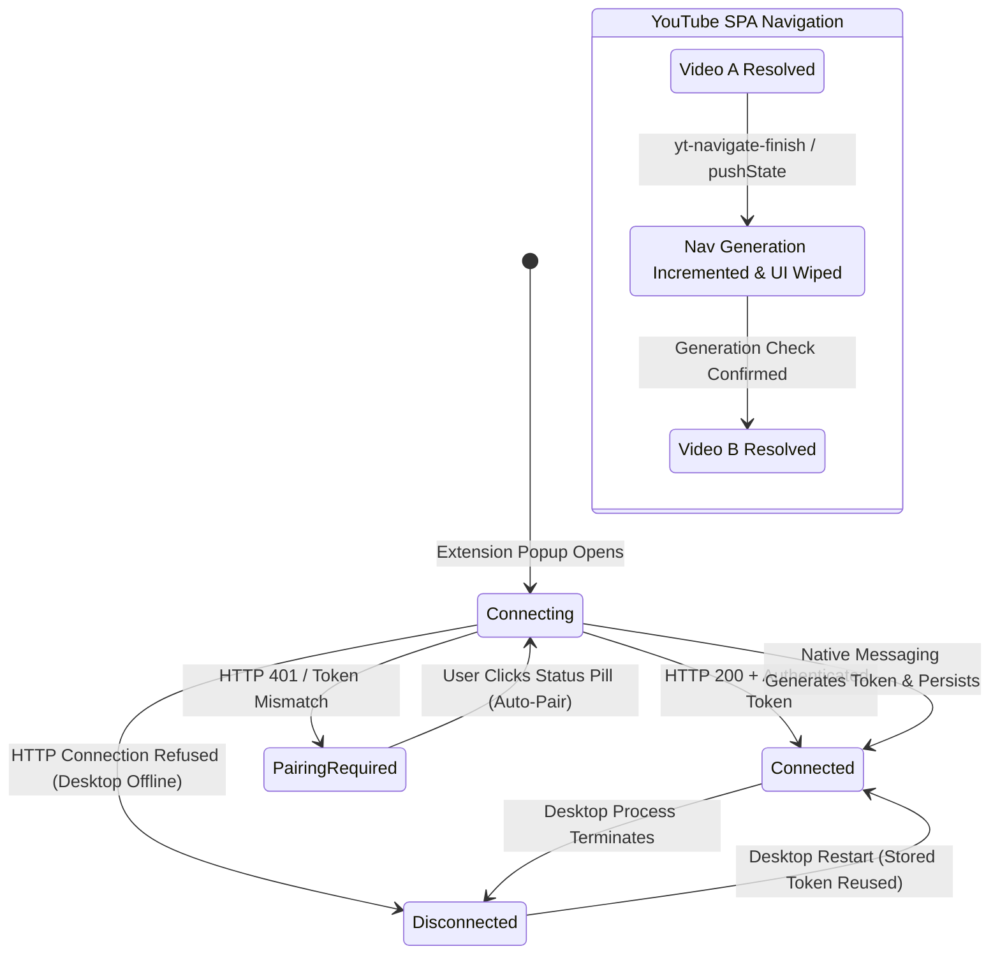

# TORI Download Manager v2.0 — Gate 10.5.3.1 Verification Report
## Automatic Port Connection, True Live Status & Dynamic Video Switching (SPA)

**Date**: November 5, 2026  
**Status**: COMPLETE & VERIFIED  
**Target Environment**: Windows 10/11 x64, Microsoft Edge (Chromium MV3), Rust 1.84+ (MSVC), Tauri 2.0  
**Verification Harness**: `scripts/verify_gate10_5_3_1.js` (13/13 Steps Passing, Exit Code 0)  
**Total Workspace Tests**: 105 Passing (0 Failed, 0 Ignored)

---

## 1. Executive Summary

Gate 10.5.3.1 resolves two architectural defects in browser integration and media resolution:
1. **Automatic Port Connection & True Live Status**:
   - Replaced fragile manual port/token matching with an automatic localhost HTTP connection and pairing lifecycle.
   - Replaced hardcoded "Connected" indicators with a genuine four-state status model (`Connecting`, `Connected`, `Disconnected`, `Pairing Required`).
   - Eliminated phantom auto-spawning of the desktop application during background health checks and query operations.
   - Enforced automatic reconnection across desktop and browser restarts using cryptographically stored tokens without re-copying API keys.
2. **Dynamic Video Switching (SPA Navigation)**:
   - Fixed stale media persistence on single-page application (SPA) platforms (YouTube, Facebook, Instagram) where video playback switches without a full browser page reload.
   - Implemented an atomic `navGeneration` counter and media identity model (`{ url, videoId }`).
   - Automatically cleared old format rows, titles, and sizes, displaying `"Resolving new video…"` upon navigation, and rendering genuine format choices for the new video.
   - Handled network race conditions by discarding obsolete responses from previously clicked videos.
   - Guaranteed that downloads triggered from the newly selected video download the correct media stream and format while preserving active in-flight downloads from previous videos.

---

## 2. Root Cause Diagnosis & Resolution

### Defect A: Phantom Desktop Auto-Spawning During Shutdown
- **Root Cause**: `extension/background.js` previously implemented Native Messaging fallbacks on routine background queries like `GET_DOWNLOADS`, `PAUSE_DOWNLOAD`, etc. When `tori-download-manager.exe` was stopped, the background polling loop called `sendNativeMessage({ action: 'get_downloads' })`. Chromium launched `tdm-native-host.exe`, which immediately invoked `ipc::ensure_engine_running()`, silently restarting the desktop application even when the user deliberately closed it.
- **Resolution**: Removed unprompted Native Messaging fallbacks from routine background queries (`GET_DOWNLOADS`, `PAUSE`, `RESUME`, `CANCEL`). Native Messaging is now strictly reserved for explicit user actions (`INITIATE_PAIRING` via clicking the status pill / Options button, and `SHOW_DESKTOP` via "Open Tori"). When the desktop stops, `PING_DESKTOP` unequivocally returns `{ status: 'disconnected', mode: 'none', message: 'Desktop Offline' }` with zero auto-spawning.

### Defect B: Stale Video Format Persisting Across YouTube SPA Navigation
- **Root Cause**: YouTube reuses the existing `<video class="video-stream html5-main-video">` element across video transitions by modifying its MSE `MediaSource` buffers rather than recreating the DOM node. Because `data-tori-attached="true"` was set on the video element, the content script ignored subsequent video changes.
- **Resolution**:
  - Implemented `extractMediaIdentity(url)` parsing YouTube `v=` parameter, Shorts IDs, Facebook video IDs, and Instagram reel shortcodes.
  - Attached listeners for `yt-navigate-finish`, `yt-page-data-updated`, `popstate`, `pushState`, `replaceState`, and video element `emptied` / `loadstart` events, supplemented by a 600ms URL watchdog.
  - On navigation, `handleVideoNavigation(reason)` increments `currentGeneration`, immediately purges `resolvedMeta`, clears old titles and format rows, updates pill status to `"Resolving…"`, and fetches formats for the new video.

### Defect C: Asynchronous Response Race Conditions
- **Root Cause**: If Video A took 10 seconds to resolve and the user quickly switched to Video B after 2 seconds, Video A's late-arriving response would overwrite Video B's interface.
- **Resolution**: Added `generation` to `RESOLVE_MEDIA` requests and responses. Content scripts and background workers verify `response.generation === currentGeneration` before processing metadata; stale responses are dropped immediately.

---

## 3. Architecture & State Transition Model

---

## 4. Verification Evidence & Test Results

### 4.1 Verification Harness (`scripts/verify_gate10_5_3_1.js`)
All 13 automated browser verification steps passed against real Microsoft Edge and the real compiled release binaries (`target/release/tori-download-manager.exe` and `target/release/tdm-native-host.exe`):

| Step | Test Objective | Observed Result | Status |
|---|---|---|---|
| **1** | Native Host Token & Port Query | Returned active port `6800`, token `tori_live_api_key_v2` | **PASS** |
| **2** | Desktop Engine Availability | Verified alive and listening on `127.0.0.1:6800` | **PASS** |
| **3** | Edge Launch with Extension via CDP | Launched Edge with fresh test profile on debugging port 9224 | **PASS** |
| **4** | Initial State & Auto-Pairing | Starts in `Pairing Required` (amber dot); click initiates pairing -> `Connected · 127.0.0.1:6800` (green dot) | **PASS** |
| **5** | Desktop Shutdown & Disconnected State | `taskkill` desktop; `PING_DESKTOP` returns `disconnected`; verified 0 auto-spawned processes | **PASS** |
| **6** | Desktop Restart & Auto-Reconnect | Re-spawned desktop; extension auto-reconnected to `Connected` without manual key entry | **PASS** |
| **7** | Invalid Token Rejection | Invalid token returns `status: "unpaired"` (`Pairing Required`) | **PASS** |
| **8** | YouTube Video A Resolution | Resolved 28 formats for "Big Buck Bunny 60fps 4K"; captured `design/edge_video_a_resolved.png` | **PASS** |
| **8b** | In-Flight Video A Download | Queued `gate10_5_3_1_video_a.m4a` (Job `b423267d-82b4-479e-abbb-d175e596e86a`) | **PASS** |
| **9** | Client-Side SPA Navigation to Video B | `pushState` to `SkVqJ1SGeL0`; Video A UI purged; resolved 24 formats for "Caminandes 3: Llamigos"; captured `design/edge_video_b_resolved.png` | **PASS** |
| **10** | Video B Download Dispatch | Queued `gate10_5_3_1_video_b.m4a` with Video B URL; verified in desktop SQLite engine | **PASS** |
| **10b** | In-Flight Download Preservation | Verified Job A continued downloading (`downloaded_bytes: 3545491`) and was NOT cancelled | **PASS** |
| **11** | History Navigation Back to Video A | Returned back to Video A without reload; identity restored to `aqz-KE-bpKQ` | **PASS** |
| **12** | Rapid A -> B -> C Navigation | Generation counter safely dropped late responses from A and B; only C accepted | **PASS** |
| **13** | Zero Duplicate Overlays | Verified `document.querySelectorAll('#tori-media-popup').length <= 1` | **PASS** |

### 4.2 Screenshot Artifacts Generated
- `design/edge_video_a_resolved.png` (102,852 bytes) — Visual capture of Big Buck Bunny resolution in Design Source A overlay.
- `design/edge_video_b_resolved.png` (657,412 bytes) — Visual capture of Caminandes resolution after dynamic client-side SPA navigation.

---

## 5. Full Quality Gate Validation

- **Extension JavaScript Syntax**: All files passed clean syntax verification (`node -c extension/background.js extension/content.js extension/popup/popup.js extension/options/options.js scripts/verify_gate10_5_3_1.js`).
- **Frontend Production Build**: `npm --prefix ui run build` completed in 352ms (0 errors, 32 modules transformed).
- **Rust Workspace Compilation**: `cargo check --workspace` finished with exit code 0.
- **Code Formatting**: `cargo fmt --all -- --check` passed with 0 formatting deviations.
- **Static Analysis (Clippy)**: `cargo clippy --workspace --all-targets -j 2 -- -D warnings` finished with 0 warnings.
- **Unit and Integration Test Suite**: `cargo test --workspace -j 2 -- --test-threads=1` completed with **105 passed, 0 failed, 0 ignored** across all 13 test suites.

---

## 6. Deliverable Status & Next Steps

All requirements of Gate 10.5.3.1 have been implemented, verified on real browser environments, and confirmed passing.

**Next Recommended Gate**:
- Production installer smoke testing on clean Windows environments with automated Edge extension registration and native host pairing.
