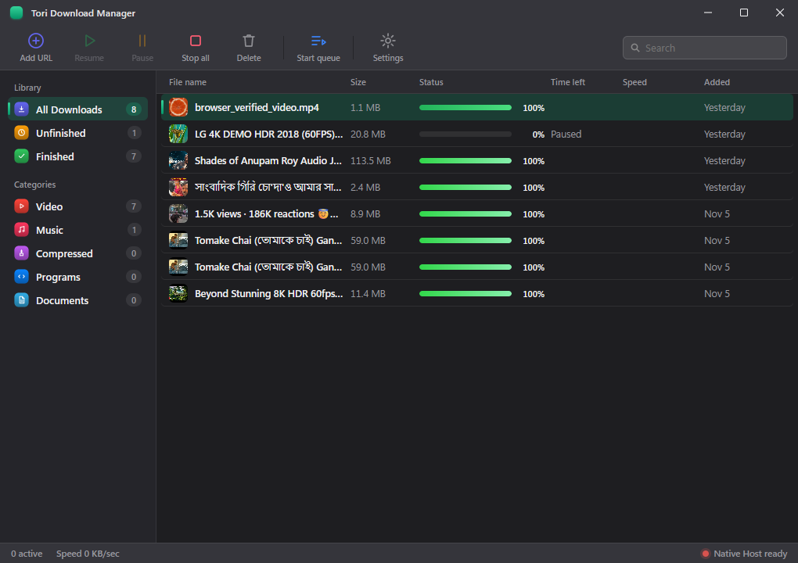
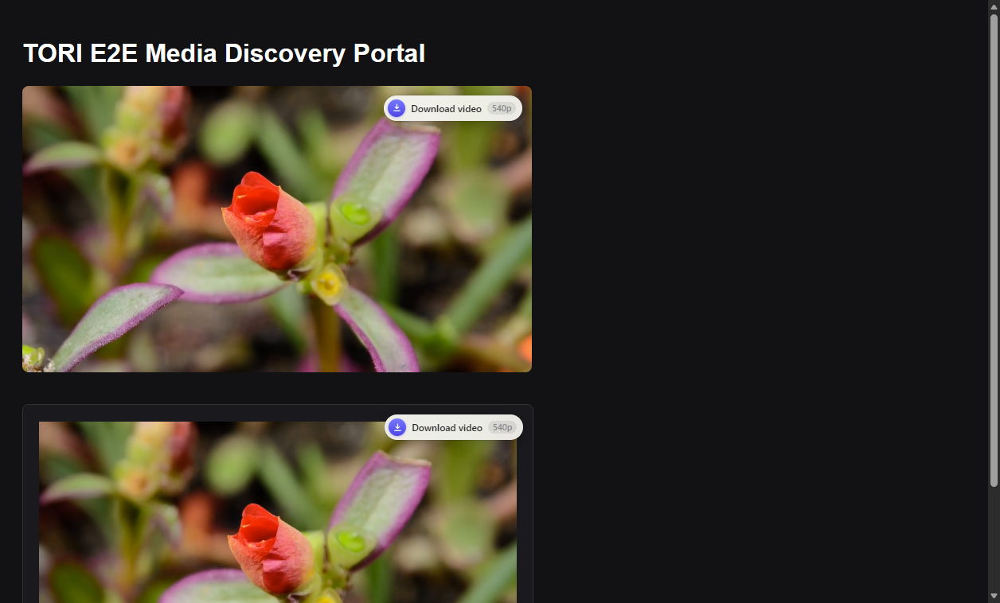
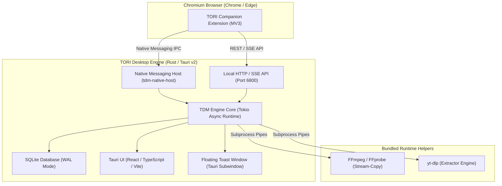

# TORI Download Manager (TDM)

<p align="center">
  
</p>

<p align="center">
  <strong>A high-speed, modern Windows desktop download manager and browser companion built with Rust, Tokio, and Tauri v2.</strong>
</p>

<p align="center">
  <a href="https://github.com/robijoychakma375-hash/tori-download-manager/releases"></a>
  <a href="LICENSE"></a>
  <a href="https://github.com/robijoychakma375-hash/tori-download-manager/issues"></a>
  
</p>

---

## Overview

**TORI Download Manager** is an open-source, resilient Windows desktop download manager engineered for raw speed, data integrity, and broad media compatibility. Powered by a multi-threaded Rust/Tokio asynchronous core and a lightweight Tauri v2 interface, TORI accelerates direct file transfers up to 32 parallel connections, captures and remuxes streaming video manifests (HLS and MPEG-DASH), downloads torrents and magnet links, and pairs with Chromium browsers via a Manifest V3 extension.

---

## Key Features

- ⚡ **Multi-Segment Ranged Transfers:** Up to 32 concurrent HTTP/HTTPS byte-range streams per download with dynamic segment boundary rebalancing and zero-byte resume leakage.
- 🎬 **HLS & MPEG-DASH Remuxing:** Native manifest parsing (`.m3u8`, `.mpd`) with automated multi-stream segmented downloading and lossless FFmpeg stream-copy container merging.
- 🧲 **BitTorrent & Magnet Links:** Integrated peer-to-peer downloading powered by `librqbit`.
- 🧩 **Manifest V3 Browser Companion:** One-click media detection for Chrome and Microsoft Edge with zero-trust local authentication and DNS-rebinding defense.
- 🔔 **Floating Download Toast:** Independent, always-on-top, resizable native notification card with live transfer speed, progress ring, and responsive controls.
- 🛡️ **Crash-Resilient State:** Transactional SQLite WAL metadata persistence guaranteeing exact resume points across abrupt process exits or system restarts.
- 📥 **System Tray & Background Persistence:** Close-to-tray background execution keeping active transfers running with Win32 working set memory trimming under 27 MB.
- 🔒 **Cryptographically Signed Auto-Updates:** In-app updates verified via Ed25519 Minisign signatures with an active-download safety collision guard.
- 📦 **100% Self-Contained Installer:** Bundles all required runtime dependencies (FFmpeg, FFprobe, yt-dlp, native messaging host) into a single offline NSIS setup.

---

## Screenshots

<p align="center">
  <strong>TORI Desktop Interface</strong><br>
  
</p>

<p align="center">
  <strong>Floating Download Toast & Real-Time Progress</strong><br>
  
</p>

<p align="center">
  <strong>Browser Companion Media Detection Overlay</strong><br>
  
</p>

---

## Installation (Windows)

### Official Setup Package

1. Download the latest installer from [GitHub Releases](https://github.com/robijoychakma375-hash/tori-download-manager/releases):
   - `TORI Download Manager_1.0.0_x64-setup.exe`
2. Run the installer. It will:
   - Install TORI Download Manager into `%LOCALAPPDATA%\Programs\TORI Download Manager`
   - Install bundled companion dependencies (`bin/ffmpeg.exe`, `bin/ffprobe.exe`, `bin/yt-dlp.exe`, `bin/tdm-native-host.exe`, `bin/tdm-cli.exe`)
   - Register the Chromium Native Messaging host manifest for Chrome and Microsoft Edge
   - Create Start Menu and Desktop shortcuts
3. Launch **TORI Download Manager** from the Start Menu.

---

## Browser Extension Setup (Chrome & Edge)

The browser companion enables one-click media detection and transfer interception directly from web pages.

### Installation from Release ZIP

1. Download `tori-download-manager-extension-v1.0.0.zip` from [GitHub Releases](https://github.com/robijoychakma375-hash/tori-download-manager/releases).
2. Extract the archive into a folder on your system.
3. Open your browser's extension management page:
   - **Google Chrome:** Navigate to `chrome://extensions/`
   - **Microsoft Edge:** Navigate to `edge://extensions/`
4. Toggle **Developer mode** ON in the top right / left sidebar.
5. Click **Load unpacked** and select the extracted folder.
6. The extension icon will appear in the toolbar. It will automatically connect to the TORI desktop engine on `127.0.0.1:6800`.

---

## Building from Source

### Prerequisites

Ensure the following tools are installed on your Windows development environment:
- **Rust & Cargo:** Stable 1.80+ (MSVC toolchain: `x86_64-pc-windows-msvc`)
- **Node.js:** v18 or later with `npm`
- **Tauri CLI:** v2 (`cargo install tauri-cli`)
- **NSIS:** 3.x (required for packaging the Windows installer)
- **C++ Build Tools:** Visual Studio 2022 C++ x64/x86 build tools

### Build Steps

1. **Clone the repository:**
   ```bash
   git clone https://github.com/robijoychakma375-hash/tori-download-manager.git
   cd tori-download-manager
   ```

2. **Install frontend dependencies:**
   ```bash
   npm --prefix ui install
   ```

3. **Build companion executables:**
   ```bash
   cargo build --release --bin tdm-cli --bin tdm-native-host
   ```

4. **Compile React frontend:**
   ```bash
   npm --prefix ui run build
   ```

5. **Build the desktop application:**
   ```bash
   cargo tauri build --no-bundle
   ```
   The standalone executable will be located at:
   `target/release/tori-download-manager.exe`

6. **Build the full NSIS self-contained installer:**
   ```bash
   cargo tauri build --bundles nsis
   ```
   The generated installer will be located at:
   `target/release/bundle/nsis/TORI Download Manager_1.0.0_x64-setup.exe`

---

## Technology Stack & Architecture



### Architecture Highlights

- **`crates/tdm-core`**: Core download engine implementing multi-segment HTTP chunking, dynamic bandwidth governors, HLS/DASH manifest parsers, torrent transfer orchestration, and crash recovery.
- **`crates/tdm-native-host`**: Native Messaging companion hosting length-prefixed standard I/O IPC and a local authenticated Axum HTTP/SSE server on `127.0.0.1:6800`.
- **`crates/tdm-cli`**: Headless command-line download tool for headless automation and testing.
- **`src-tauri`**: Tauri v2 application bridge integrating Windows System Tray, Win32 memory working set trimming, multi-window management, and Ed25519 auto-updater.
- **`ui`**: Production React 18 interface with custom titlebar, dark mode tokens, and real-time speed graphing.
- **`extension`**: Manifest V3 extension featuring automatic stream detection, format picker popups, and secure auto-pairing.

---

## Third-Party Software & Licensing

TORI Download Manager is open source and dual-licensed under either:
- **MIT License** ([`LICENSE-MIT`](LICENSE-MIT) or [opensource.org/licenses/MIT](https://opensource.org/licenses/MIT))
- **Apache License, Version 2.0** ([`LICENSE-APACHE`](LICENSE-APACHE) or [apache.org/licenses/LICENSE-2.0](https://www.apache.org/licenses/LICENSE-2.0))

### Bundled Third-Party Components

Detailed third-party notices and licenses are documented in [`resources/LICENSE-THIRD-PARTY.txt`](resources/LICENSE-THIRD-PARTY.txt):

1. **FFmpeg & FFprobe:** Licensed under the GNU General Public License v3 (GPLv3). Bundled as standalone, unmodified companion executables invoked via standard operating system process pipes. Source code availability:
   - Official FFmpeg repository: [ffmpeg.org/download.html](https://ffmpeg.org/download.html)
   - Autobuild recipes: [github.com/yt-dlp/FFmpeg-Builds](https://github.com/yt-dlp/FFmpeg-Builds)
2. **yt-dlp:** Released into the Public Domain under The Unlicense ([github.com/yt-dlp/yt-dlp](https://github.com/yt-dlp/yt-dlp)).
3. **librqbit:** BitTorrent client engine licensed under the Apache License 2.0 ([github.com/ikatson/librqbit](https://github.com/ikatson/librqbit)).

---

## Contributing

Contributions, bug reports, and suggestions are welcome!

1. Fork the repository on GitHub.
2. Create a feature branch: `git checkout -b feature/my-new-feature`.
3. Ensure formatting and clippy checks pass:
   ```bash
   cargo fmt --all -- --check
   cargo clippy --workspace --all-targets -- -D warnings
   cargo test --workspace
   ```
4. Commit your changes: `git commit -m "feat: add my new feature"`.
5. Push to the branch: `git push origin feature/my-new-feature`.
6. Open a Pull Request.

---

## Feedback & Issues

- For bug reports and feature requests, please use [GitHub Issues](https://github.com/robijoychakma375-hash/tori-download-manager/issues).
- For release notes and changelogs, consult [`RELEASE_NOTES.md`](RELEASE_NOTES.md) and [`CHANGELOG.md`](CHANGELOG.md).
