# TORI Browser Companion — Gate 25 Overlay Drag Hotfix Report

---

## Executive Summary

| Attribute | Value |
|---|---|
| **Hotfix Scope** | Browser Extension Video Download Overlay Mouse Dragging State Machine |
| **Branch** | `hotfix/overlay-drag` |
| **Commit Hash** | `cfb0bf92a477f6020a87c5f51a1eb418e63903ce` |
| **Target Extension Version** | `1.0.5` |
| **Desktop Version** | `1.0.3` (Strictly Unchanged) |
| **Cross-Browser Verification** | Microsoft Edge, Google Chrome, Mozilla Firefox (39/39 Scenarios Passed) |
| **Regression Test Audits** | 25/25 Migration Audit Passed, 26/26 Engine Smoke Tests Passed |
| **Packaging Status** | v1.0.5 Chromium & Firefox ZIPs built, linted (0 errors), audited, and staged |
| **Production Publication** | Not published (Awaiting User Sign-off & Mozilla AMO / CWS Submission) |

---

## 1. Exact Root Cause Investigation

### The Reported Phenomenon
1. Clicking the floating download pill once caused the pill to attach to and follow the mouse cursor.
2. The overlay continued moving across the screen even after the mouse button was completely released.
3. The user could not click other page controls or video controls normally.
4. Dragging behaved like a sticky toggle rather than a standard click-and-hold drag gesture.

### Technical Analysis of the Failure Mode
Investigation of `extension/content.js` and `extension/firefox/content.js` revealed three compound design flaws:

1. **Event Bubbling Interception by `isolateEvents`**:
   Lines 698–708 originally registered a generic isolation listener:
   ```javascript
   const isolateEvents = (el) => {
     ['pointerdown', 'pointerup', 'mousedown', 'mouseup', 'click', 'dblclick', 'touchstart', 'touchend', 'contextmenu'].forEach((evt) => {
       el.addEventListener(evt, (e) => { e.stopPropagation(); });
     });
   };
   isolateEvents(pill);
   ```
   When a user clicked on `pill`, the browser dispatched `pointerdown` to `pill`, setting `isPointerDown = true` and registering `window.addEventListener('pointerup', onPointerUp)` in the default **bubbling** phase (`capture: false`).
   When the user released the mouse over `pill`, `pill` dispatched `pointerup`. `isolateEvents(pill)` intercepted this event and called `e.stopPropagation()`. As a result, the event **never bubbled up to `window`**. The window's `onPointerUp` listener was never invoked, leaving `isPointerDown` stuck as `true` and the window's `pointermove` listener active indefinitely.

2. **Absence of Mouse Button State (`e.buttons`) Validation**:
   When the user moved the mouse cursor afterward with **no buttons held down** (`e.buttons === 0`), `window.onPointerMove` was triggered. Because `isPointerDown` was still `true`, the distance exceeded the 5px threshold (`Math.hypot(dx, dy) >= 5`), immediately transitioning `isDragging = true`, setting `tori-dragging`, and invoking `pill.setPointerCapture(e.pointerId)`. The overlay was now actively tracking the mouse cursor without the user pressing any mouse button.

3. **Trapped Pointer Capture Lifecycle**:
   Once `pill.setPointerCapture` was called, all pointer events were redirected to `pill`. Any subsequent click or mouse release attempt was routed to `pill`, where `isolateEvents(pill)` again swallowed `pointerup`, making it impossible to exit the dragging state.

---

## 2. Files Changed

| File Path | Change Description |
|---|---|
| [`extension/content.js`](file:///F:/TORI/final%20tori%20download%20manager/extension/content.js) | Refactored drag state machine, removed pointer events from generic isolation, added window capture-phase lifecycle listeners, added `(e.buttons & 1)` validation, added `lostpointercapture` and `blur` handlers. |
| [`extension/firefox/content.js`](file:///F:/TORI/final%20tori%20download%20manager/extension/firefox/content.js) | Synchronized identical refactored drag implementation (100% byte parity preserved). |
| [`extension/manifest.json`](file:///F:/TORI/final%20tori%20download%20manager/extension/manifest.json) | Version bumped from `1.0.4` to `1.0.5`. |
| [`extension/firefox/manifest.json`](file:///F:/TORI/final%20tori%20download%20manager/extension/firefox/manifest.json) | Version bumped from `1.0.4` to `1.0.5`. |
| [`scripts/verify_overlay_drag_fix.js`](file:///F:/TORI/final%20tori%20download%20manager/scripts/verify_overlay_drag_fix.js) | Automated cross-browser test runner covering all 12 scenarios on Edge, Chrome, and Firefox via CDP and Marionette. |
| [`scripts/capture_drag_behavior_evidence.js`](file:///F:/TORI/final%20tori%20download%20manager/scripts/capture_drag_behavior_evidence.js) | Automated side-by-side behavioral comparison capturing empirical before/after evidence. |
| [`scripts/package_v1_0_5_extensions.js`](file:///F:/TORI/final%20tori%20download%20manager/scripts/package_v1_0_5_extensions.js) | Production packaging script for v1.0.5 packages with entry auditing and `web-ext lint`. |
| [`scripts/verify_final_extension_ui_migration.js`](file:///F:/TORI/final%20tori%20download%20manager/scripts/verify_final_extension_ui_migration.js) | Updated version check to validate v1.0.5 consistency across manifests. |

---

## 3. Drag State Machine Refactoring

### Architecture Comparison

```mermaid
flowchart TD
    subgraph OLD["Old Faulty Drag Pipeline"]
        O1["pointerdown on pill"] --> O2["isPointerDown = true"]
        O2 --> O3["window.addEventListener('pointerup', onPointerUp, bubble)"]
        O3 --> O4["pointerup fires on pill"]
        O4 --> O5["isolateEvents calls e.stopPropagation()"]
        O5 --> O6["window NEVER receives pointerup!"]
        O6 --> O7["isPointerDown remains true"]
        O7 --> O8["Mouse moves with buttons=0"]
        O8 --> O9["dx >= 5px -> isDragging = true (Sticky Drag Bug)"]
    end

    subgraph NEW["Refactored Robust Pointer State Machine"]
        N1["pointerdown on pill (button === 0)"] --> N2["isPointerDown = true; activePointerId = id"]
        N2 --> N3["window.addEventListener('pointerup', onPointerUp, CAPTURE)"]
        N2 --> N4["pill.addEventListener('pointerup', onPointerUp)"]
        N2 --> N5["window.addEventListener('blur'); pill.addEventListener('lostpointercapture')"]
        
        N3 & N4 --> N6{"Gesture Type?"}
        N6 -- "Click / Release < 5px" --> N7["endDrag() resets isPointerDown = false; didDrag = false"]
        N7 --> N8["click fires -> wasDragged is false -> Panel opens/closes cleanly"]
        
        N6 -- "Hold & Move >= 5px" --> N9["isDragging = true; pill.setPointerCapture()"]
        N9 --> N10["Overlay tracks cursor within container bounds"]
        N10 --> N11["pointerup / buttons === 0 / blur / lostcapture"]
        N11 --> N12["endDrag() releases capture; saves pos; wasDragged = true (suppresses click)"]
        N12 --> N13["Overlay stops moving immediately. Cursor moves without holding never move overlay"]
    end
```



### Key Engineering Implementations

1. **Capturing Phase Registration (`{ capture: true }`)**:
   By attaching `pointermove`, `pointerup`, and `pointercancel` to `window` with `{ capture: true }`, events are dispatched at Step 1 of the W3C DOM dispatch lifecycle. They execute before reaching child targets, meaning child `stopPropagation()` calls cannot suppress window tracking.

2. **Direct Hardware Button State Check (`(e.buttons & 1) === 0`)**:
   Inside `onPointerMove`:
   ```javascript
   if (e.pointerType === 'mouse' && (e.buttons & 1) === 0) {
     endDrag(e, false);
     return;
   }
   ```
   If the physical left mouse button is not currently depressed, any active or pending drag is terminated instantly.

3. **Multi-Source Interruption Teardown**:
   The gesture is safely cleared on:
   - `pointerup` (both window capture and element target)
   - `pointercancel` (hardware disruption or OS interruption)
   - `lostpointercapture` (browser capture termination)
   - `window.blur` (Alt+Tab, tab switching, or dialog popup)

4. **Surgical Isolation Refinement**:
   Removed `pointerdown` and `pointerup` from the generic blind `isolateEvents` helper, allowing pointer lifecycles to be managed by dedicated handlers while keeping `click`, `mousedown`, and `mouseup` isolated from video player controls.

---

## 4. Empirical Before vs After Behavioral Evidence

Automated evidence captured in real headless Edge via CDP (`scripts/capture_drag_behavior_evidence.js`):

| Test Scenario | Old Implementation (v1.0.4) | Hotfix Implementation (v1.0.5) | Verdict |
|---|---|---|---|
| **Single click on floating pill** | `isPanelOpen: true`, `left: 0` | `isPanelOpen: true`, `left: 0` | Panel opens cleanly in both |
| **Cursor move after release (buttons: 0)** | `isDragging: true`, `left: 296px` | `isDragging: false`, `left: 0px` | **FIXED** (Stuck drag eliminated) |
| **Dragging state flag after release** | `tori-dragging` permanently present | `tori-dragging` cleanly removed | **FIXED** |
| **Secondary click to close panel** | Trapped by captured pointer | Panel toggles closed (`isPanelOpen: false`) | **FIXED** |
| **Other page control clicks** | Blocked / intercepted | Counter button clicks increment cleanly | **FIXED** |

---

## 5. Cross-Browser Verification Results

Automated execution via `scripts/verify_overlay_drag_fix.js` tested all 12 scenarios plus Shadow DOM handling across three distinct browser engines:

| Scenario # | Scenario Description | Microsoft Edge | Google Chrome | Mozilla Firefox |
|:---:|---|:---:|:---:|:---:|
| **SETUP** | Floating download pill injected over video element | **PASS** | **PASS** | **PASS** |
| **1** | Single click and release opens panel without moving overlay | **PASS** | **PASS** | **PASS** |
| **2** | Second click and release closes panel without moving overlay | **PASS** | **PASS** | **PASS** |
| **3** | Holding mouse and moving < 5px does not drag | **PASS** | **PASS** | **PASS** |
| **4 & 5** | Holding mouse and moving > 5px drags; release stops movement | **PASS** | **PASS** | **PASS** |
| **6** | Moving cursor without holding button never moves overlay | **PASS** | **PASS** | **PASS** |
| **7** | Clicking another page control works normally without interference | **PASS** | **PASS** | **PASS** |
| **8** | Repeated consecutive drag operations complete cleanly | **PASS** | **PASS** | **PASS** |
| **9** | Moving outside bounds clamps overlay within player container | **PASS** | **PASS** | **PASS** |
| **10** | Window blur and pointercancel immediately reset drag state | **PASS** | **PASS** | **PASS** |
| **11** | Relative coordinates persist in attributes and storage | **PASS** | **PASS** | **PASS** |
| **12** | Format panel controls and Download button work normally | **PASS** | **PASS** | **PASS** |
| **13** | Shadow DOM video player overlay detected & interactive across boundary | **PASS** | **PASS** | **PASS** |
| **TOTAL** | **Passed Tests per Browser Engine** | **13 / 13** | **13 / 13** | **13 / 13** |

**Total Cross-Browser Score:** **39 / 39 PASSED (100.0%)**

---

## 6. Functional Regression Audits

### 1. Final Extension UI Migration Suite (`verify_final_extension_ui_migration.js`)
- **25 / 25 PASSED (100%)**
- Verified: Parity between Chromium and Firefox, zero demo states, version consistency, real TORI Desktop v1.0.3 server integration on `127.0.0.1:6800`, popup connected/disconnected transitions, gear settings navigation, capture toggles, 5px drag threshold enforcement, format panel expansion, audio/video segmented tabs, and stream classification.

### 2. End-to-End Download Engine & UI Smoke Suite (`verify_gate24_smoke_tests.js`)
- **26 / 26 PASSED (100%)**
- Verified: Real engine launch (PID 27280), `/api/v1/ping`, `/api/v1/media/resolve`, end-to-end 512KB direct video download job execution, file output written to `downloads/Video/sample-video.mp4`, SHA-256 byte-level identity match (`0ed35ffa9e72a743...`), download pause/resume lifecycle APIs, overlay injection and dragging, format picker download dispatch, and panel closing.

---

## 7. Extension v1.0.5 Packaging & Release Readiness

Both extension packages were compiled, audited, and staged in `release/v1.0.5-extension` using `scripts/package_v1_0_5_extensions.js`:

| Package Asset | Size | SHA-256 Checksum | Audit Status |
|---|---|---|---|
| `tori-download-manager-extension-v1.0.5.zip` | 73,398 bytes | `ee0a6b133400665cb141185eb8c8bcfd982cdafec3a72309b7f64c097bb17530` | Validated (40 forward-slash entries, 0 backslashes, root manifest.json, 0 preview files) |
| `tori-download-manager-firefox-v1.0.5.zip` | 73,122 bytes | `f57921215cffa39e537ef07f654dd35ffcd296d6de7b395f85baec6cdcee912b` | Validated (`web-ext lint` 0 errors, Gecko ID preserved, AMO compliant) |
| `SHA256SUMS.txt` | 178 bytes | Generated | Checksums verified against physical archive files |

---

## 8. Safety & Scope Commitments

1. **Desktop Engine v1.0.3**: Kept strictly untouched. Workspace Cargo files, Rust code, NSIS installer, and binaries were not modified.
2. **Public Updater Endpoint**: Untouched. The public auto-updater continues serving `1.0.3` metadata.
3. **Official Website**: Untouched.
4. **Git State**: Local checkpoint established on dedicated hotfix branch `hotfix/overlay-drag` at commit `cfb0bf92a477f6020a87c5f51a1eb418e63903ce`. Working tree is clean.
5. **Release Distribution**: v1.0.5 packages are staged locally only. No release has been published to GitHub or third-party stores.
