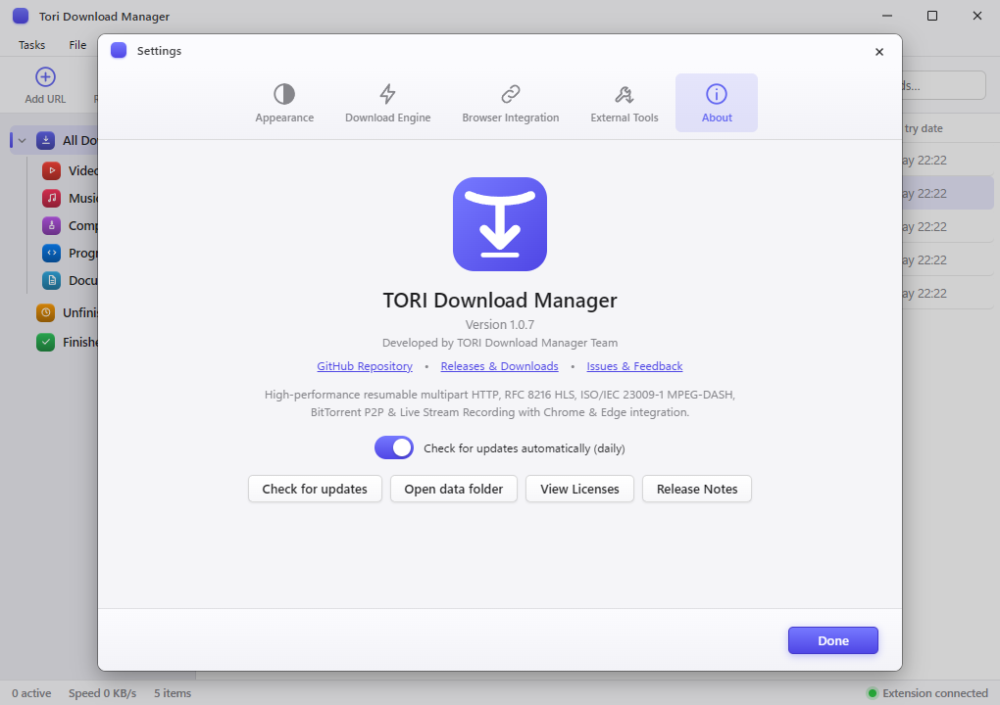
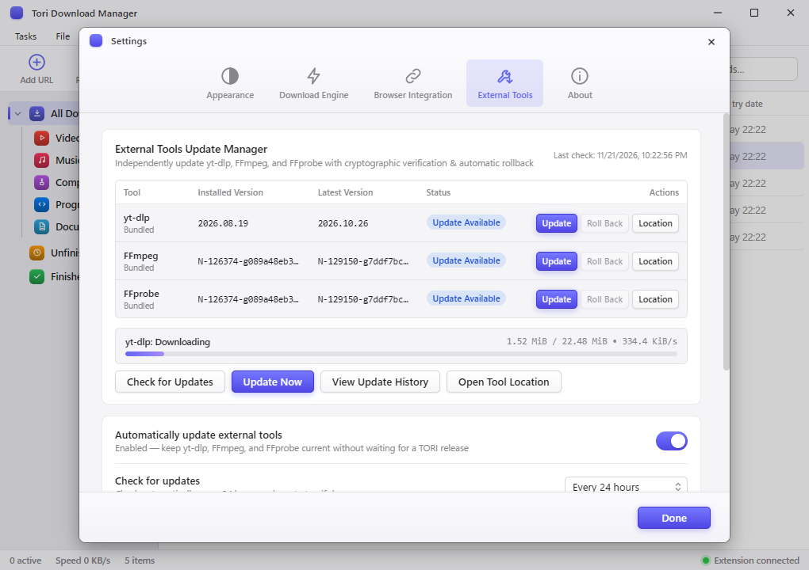
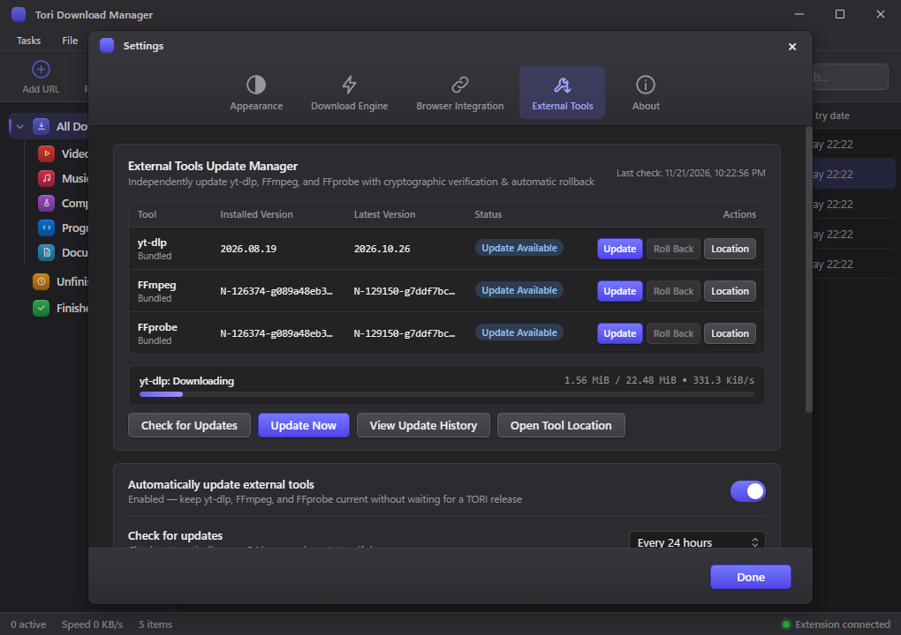

# TORI Download Manager — Gate 32.2 Engineering Report
# Desktop v1.0.7 Release Candidate & Production Tools Manifest Preflight

**Report Date:** 2026-11-22  
**Gate:** Gate 32.2 — Desktop `v1.0.7` Release Candidate & Production Tools Manifest Preflight  
**Release Type:** Local Release Candidate & Preflight ONLY — **PUBLIC RELEASE NOT PERFORMED**  
**Development Branch:** `release/v1.0.7-rc`  
**Baseline Commit / Tag:** `5edb2c53348249154df9ececdad34114e715198e` (`checkpoint-gate32_1-verified` / `checkpoint-gate32_2-before-rc`)  
**Target Desktop RC:** `v1.0.7-rc` (`1.0.7`)  
**Public Desktop Baseline (Unchanged):** `v1.0.6` (GitHub Release ID `453599579`)  
**Public Browser Companion (Unchanged):** `v1.0.10` (GitHub Release ID `451270856`)  
**Final Verdict:** **CONDITIONAL GO** (all 12 mandatory regression suites — 433 automated assertions + static analysis + frontend build — PASS with 0 FAIL / 0 TIMEOUT / 0 SKIPPED; conditional only on operator acceptance of the two pre-existing environment limitations: no Windows Authenticode certificate and no independent clean Windows VM).

---

## 1. Executive Summary

Gate 32.2 prepared, hardened, built, cryptographically signed, and exhaustively preflight-tested **TORI Download Manager Desktop `v1.0.7-rc`**, integrating the Gate 32 and Gate 32.1 **Independent External Tools Auto-Update Manager** (`yt-dlp`, `FFmpeg`, `FFprobe`) for production deployment while strictly preserving all public production surfaces (`Desktop v1.0.6`, `latest.json`, `Browser Companion v1.0.10`, and `https://toridownload.xyz`).

Key engineering outcomes:
- **Subprocess Lease Hardening:** Audited every `yt-dlp`, `FFmpeg`, and `FFprobe` invocation across `tdm-core` and closed an extraction lease gap in `crates/tdm-core/src/resolver/extractor.rs` so `execute_yt_dlp_dump` and `execute_yt_dlp_playlist_dump` acquire RAII `FFmpeg` + `FFprobe` leases alongside `yt-dlp` whenever `--ffmpeg-location` is supplied.
- **Version & Updater Readiness (`1.0.6 → 1.0.7`):** Updated workspace crate metadata, Windows PE FileVersion/ProductVersion (`1.0.7`), Tauri bundle config, UI version/release notes, dynamic `User-Agent`, and Ed25519 cryptography unit tests.
- **Signed Desktop `v1.0.7-rc` Installer:** Built and signed `release/v1.0.7-rc/TORI Download Manager_1.0.7_x64-setup.exe` (`118,097,450` bytes) with out-of-repo production Ed25519 updater key `CDC23D8CC8DA5397`, generating `.sig`, `draft_latest.json` (unpublished), `SHA256SUMS.txt`, `BUILD_METADATA.json`, `RELEASE_MANIFEST.json`, `RELEASE_NOTES_v1.0.7.md`, and `INSTALLATION_AND_UPGRADE.md`.
- **Production Tools Manifest Prepared (Unpublished):** Generated and Ed25519-signed `release/v1.0.7-rc/tools-manifest-production/tools-manifest.json` (`schema_version: 2`, `manifest_revision: 1`, valid 45 days until `2027-01-05T16:00:29.945Z`) and `.sig` referencing the immutable `BtbN/FFmpeg-Builds` artifact mirrored on GitHub (`tools-ffmpeg-N-129150-g7ddf7bc8a4`, `205,445,856` bytes), verified via Rust cryptography tests, and kept strictly local pending Gate 32.3 promotion approval.
- **Real In-Place `v1.0.6 → v1.0.7-rc` Upgrade Verified:** Executed a physical silent NSIS upgrade from public `v1.0.6` to `v1.0.7-rc` in an isolated install directory (`G322-01`..`G322-19`: **19/19 PASS**), confirming SQLite additive migration, byte-identical `.tdm-part` preservation and genuine mid-transfer pause/resume to exact SHA-256 (`G322-07`), standalone IDM Progress Window (no legacy toast), live HTTPS staging manifest + OpenPGP `yt-dlp` updates, active download protection during updates & rollback, and full Browser Companion `v1.0.10` compatibility (Native Messaging stdio + HTTP fallback + Mozilla-signed Firefox XPI live MKV capture).
- **Full 12-Suite Regression Matrix Passed:** All **12/12** mandatory test suites passed (**433 PASS, 0 FAIL, 0 TIMEOUT, 0 SKIPPED** plus `cargo clippy` `0` errors and `ui` lint/build `0` errors).
- **Strict Release Boundary Enforced:** Zero public releases, zero GitHub mutations, zero Cloudflare Pages/website mutations (`tori-website` untouched at `8cd035f`), and zero Browser Companion `v1.0.10` changes occurred.

### Evidence Classification Matrix (Strict Boundary Discipline)

| Category | Exact Scope & Artifacts |
| :--- | :--- |
| **Verified locally** | `v1.0.7-rc` release build & NSIS installer (`TORI Download Manager_1.0.7_x64-setup.exe` + `.sig`), `draft_latest.json`, local production `tools-manifest-production/tools-manifest.json` + `.sig`, Rust workspace `271/271 PASS` (including `updater_cryptography_tests` `8/8` and `external_tools_updater_tests` `11/11`), `cargo clippy` (`0` errors), UI lint/build (`0` errors), real isolated `v1.0.6 → v1.0.7-rc` NSIS upgrade (`19/19 PASS`), active download protection, crash/resume/concurrency/stability (`Gate 29.1` `20/20`, `Gate 29.2` `17/17`, `Gate 29.4` `18/18`, `Gate 31.4` `15/15`, `Gate 31.5` `23/23`), and offline/error/rollback/quarantine suites. |
| **Verified against live staging** | Live HTTPS fetch & Ed25519 verification (`CDC23D8CC8DA5397`) of `https://toridownload.xyz/assets/tools/staging/tools-manifest.json` + `.sig`, live `205,445,856`-byte HTTPS download/verification/self-test/atomic activation/rollback/reapply of `FFmpeg` + `FFprobe` `N-129150-g7ddf7bc8a4-20261120` (`Gate 32.1` `19/19 PASS` on `v1.0.7` binary; `G322-10` live check in upgraded `v1.0.7`), live OpenPGP RSA-4096 `yt-dlp` `2026.08.19 → 2026.10.26` update & real YouTube extraction/merge/playlist/audio downloads (`Gate 32` `18/18`, `Gate 32.1` `19/19`, `Gate 32.2` `19/19`). |
| **Prepared for production** | Frozen `release/v1.0.7-rc/` deliverables (installer, `.sig`, standalone binaries, `SHA256SUMS.txt`, `draft_latest.json`, `RELEASE_NOTES_v1.0.7.md`, `INSTALLATION_AND_UPGRADE.md`) and `release/v1.0.7-rc/tools-manifest-production/` (`tools-manifest.json` rev `1`, `.sig`, `SHA256SUMS.txt`, `PROMOTION_PLAN.json`) targeting `https://toridownload.xyz/assets/tools/tools-manifest.json`. |
| **Published to production** | **NONE IN GATE 32.2.** Existing public surfaces verified completely unchanged via `Gate 31.6` (`13/13 PASS`): Desktop `v1.0.6` (`id=453599579`), `latest.json` (`1.0.6`), Browser Companion `v1.0.10` (`id=451270856`), `https://toridownload.xyz` (`8cd035f`), and `https://toridownload.xyz/assets/tools/tools-manifest.json` remains unpublished (`404`/absent). |
| **Not tested** | (1) Windows Authenticode signature verification / SmartScreen reputation (no Authenticode code-signing certificate is provisioned); (2) Independent clean Windows VM installation/upgrade (all testing used isolated same-host environments); (3) Live in-app Tauri Desktop auto-updater download from public GitHub `v1.0.7` (intentionally blocked until Gate 32.3 publishes `v1.0.7` and updates public `latest.json`); (4) Live fetch from production URL `https://toridownload.xyz/assets/tools/tools-manifest.json` (intentionally unpublished until Gate 32.3). |

---

## 2. Baseline Git Commit

| Field | Value |
| :--- | :--- |
| Main Repository | `F:\TORI\final tori download manager` |
| Baseline Branch | `feat/gate32-external-tools-updater` |
| Baseline Commit SHA | `5edb2c53348249154df9ececdad34114e715198e` |
| Baseline Verified Tag | `checkpoint-gate32_1-verified` |
| Pre-RC Safety Tag | `checkpoint-gate32_2-before-rc` (created at `5edb2c53348249154df9ececdad34114e715198e`) |
| Gate 32.2 Development Branch | `release/v1.0.7-rc` |
| Website Repository | `C:\Users\ritud\Downloads\tori-website` (`main` at `8cd035f1df0e6bd486db001340c001e1fa42ce4e`, clean, untouched) |

---

## 3. Changed Source Files

Every tracked change on `release/v1.0.7-rc` is tightly scoped to Gate 32.2 release-candidate preparation, subprocess lease hardening, cryptographic RC tests, and verification tooling:

| File | Purpose |
| :--- | :--- |
| `Cargo.toml` | Bumped `[workspace.package] version` from `"1.0.6"` to `"1.0.7"` (propagates across `tdm-core`, `tdm-cli`, `tdm-native-host`, `tori-download-manager`, PE version resources, and `ToolsManagerConfig::current_tori_version`). |
| `Cargo.lock` | Updated workspace member versions to `1.0.7` (zero third-party dependency changes). |
| `src-tauri/tauri.conf.json` | Bumped Tauri application `"version"` from `"1.0.6"` to `"1.0.7"`; preserved updater pubkey (`CDC23D8CC8DA5397`), endpoint (`releases/latest/download/latest.json`), and `createUpdaterArtifacts: true`. |
| `ui/package.json` | Bumped frontend package `"version"` from `"1.0.6"` to `"1.0.7"`. |
| `ui/src/components/SettingsModal.tsx` | Updated About fallback version to `1.0.7` and updated in-app Release Notes modal to reflect `v1.0.7` External Tools Auto-Update Manager features while preserving `v1.0.6` history. |
| `crates/tdm-core/src/resolver/extractor.rs` | Hardened `execute_yt_dlp_dump` and `execute_yt_dlp_playlist_dump` to acquire RAII `ffmpeg_lease` + `_ffprobe_lease` alongside `yt_dlp_lease` whenever passing `--ffmpeg-location`. |
| `crates/tdm-core/src/tools/trust.rs` | Switched HTTP client `User-Agent` to dynamic `format!("TORI-Download-Manager/{}", env!("CARGO_PKG_VERSION"))` so `v1.0.7` accurately identifies itself without manual string drift. |
| `crates/tdm-core/tests/updater_cryptography_tests.rs` | Retained all `v1.0.6-rc` tests and added `test_v107_release_candidate_signature_draft_updater_and_production_tools_manifest` verifying `v1.0.7-rc` NSIS installer Ed25519 `.sig`, tampered-installer rejection, `draft_latest.json`, `ToolsManagerConfig` production endpoint guard (never targeting `/staging/`), and prepared local production `tools-manifest.json` + `.sig`. |
| `scripts/publish_trusted_tools_manifest.js` | Added `--prepare-production-manifest` mode to generate and Ed25519-sign the local unpublished production `tools-manifest.json`, `.sig`, `SHA256SUMS.txt`, and `PROMOTION_PLAN.json` into `release/v1.0.7-rc/tools-manifest-production/` without touching `tori-website`. |
| `scripts/verify_gate32_2_v107_rc_preflight.js` | New end-to-end Gate 32.2 preflight & real `v1.0.6 → v1.0.7-rc` upgrade verification harness (`G322-01`..`G322-19`, 19 assertions). |
| `scripts/verify_gate29_4_final_integration.js` | Hardened `G294-INST-02` console check to assert both `visibleConsoleCount === 0` immediately (distinguishing Windows kernel headless `CREATE_NO_WINDOW` `conhost.exe 0x4` during Gate 32's first-boot `yt-dlp --version` probe) and `consoleCount === 0` once settled (`<= 5s`); hardened `registerQaNativeHosts()` to exclude host browser live Chrome/Edge production extension IDs from QA manifests. |
| `docs/reports/screenshots/gate32_2/*` | 3 captured Desktop `v1.0.7` Settings screenshots (About Light, External Tools Light, External Tools Dark). |
| `docs/reports/GATE32_2_DESKTOP_V107_RC_AND_MANIFEST_PREFLIGHT_REPORT.md` | This engineering report. |

Untracked/gitignored build artifacts staged strictly locally under `release/v1.0.7-rc/` (gitignored per `.gitignore:19`, matching `release/v1.0.6-rc/` precedent) and synced `resources/bin/tdm-native-host.exe` + `tdm-cli.exe` (gitignored per `.gitignore:12`).

---

## 4. Desktop Version Changes

| Component / Artifact | Before (`v1.0.6`) | After (`v1.0.7-rc`) | Verified Method |
| :--- | :--- | :--- | :--- |
| Workspace Cargo Version (`Cargo.toml`) | `1.0.6` | `1.0.7` | `cargo test --workspace` + source inspection |
| Tauri Config (`src-tauri/tauri.conf.json`) | `1.0.6` | `1.0.7` | Source + built PE metadata |
| Frontend Package (`ui/package.json`) | `1.0.6` | `1.0.7` | `npm --prefix ui run build` (`ui@1.0.7`) |
| `tori-download-manager.exe` PE FileVersion / ProductVersion | `1.0.6` | `1.0.7` | `G322-02` (`peVersion=1.0.7`) & `G294-INST-01` |
| In-App `get_app_version` IPC & Settings → About | `1.0.6` | `1.0.7` | `G322-06`, `G322-10`, `Gate 29.1 UI-SET-ABOUT`, Screenshot 1 |
| `ToolsManagerConfig::current_tori_version` | `1.0.6` | `1.0.7` | `env!("CARGO_PKG_VERSION")` + `updater_cryptography_tests` |
| External Tools HTTP `User-Agent` | `TORI-Download-Manager/1.0.6` | `TORI-Download-Manager/1.0.7` | `crates/tdm-core/src/tools/trust.rs` |
| Browser Companion (Public) | `1.0.10` | `1.0.10` (**UNCHANGED**) | `G322-03` & `Gate 31.6 EXT-V1010-HASHES` |

---

## 5. Build Configuration

- **Toolchain:** Rust release workspace build (`--release`) + Vite `8.3.5` / TypeScript (`ui@1.0.7`, `tsc -b && vite build`) + Tauri v2 NSIS bundler (`scripts/build_nsis_installer.ps1`).
- **Companion Binary Sync:** `tdm-native-host.exe` (`19,364,864` B) and `tdm-cli.exe` (`17,018,368` B) compiled in release mode (`v1.0.7`) and synced byte-identically to `resources/bin/` prior to NSIS bundling (verified bit-for-bit in `G322-02` and `G294-INST-01`).
- **Bundled External Tools (Shipped Inside Installer `<install_dir>\bin\`):**
  - `yt-dlp.exe`: `2026.08.19`
  - `ffmpeg.exe`: `N-126374-g089a48eb36-20260831`
  - `ffprobe.exe`: `N-126374-g089a48eb36-20260831`
  - `tdm-native-host.exe` (`v1.0.7`), `tdm-cli.exe` (`v1.0.7`), and `LICENSE-THIRD-PARTY.txt`.
- **Installer Mode:** NSIS per-user (`currentUser`), default install directory `%LOCALAPPDATA%\TORI Download Manager`, custom hooks preserved (`NSIS_HOOK_PREINSTALL` stale `%TEMP%`/QA path guard; `NSIS_HOOK_POSTINSTALL` lingering instance cleanup + `tdm-native-host.exe --register`).
- **Updater Artifacts:** `bundle.createUpdaterArtifacts: true` in `src-tauri/tauri.conf.json`; signed using out-of-repo production key `%USERPROFILE%\.tori-keys\tori-updater.key` (key ID `CDC23D8CC8DA5397`, passphrase never logged or committed).

---

## 6. Signing-Key Audit

| Property | Desktop Updater (`tauri.conf.json`) | External Tools Manifest (`trust.rs`) | `yt-dlp` Official Releases (`trust.rs`) |
| :--- | :--- | :--- | :--- |
| Algorithm | Ed25519 (Minisign / Tauri format) | Ed25519 (Minisign format) | OpenPGP V4 RSA-4096 detached signature (pure Rust) |
| Key ID / Fingerprint | `CDC23D8CC8DA5397` | `CDC23D8CC8DA5397` | `AC0CBBE6848D6A873464AF4E57CF65933B5A7581` |
| Private Key Storage | Out-of-repo `%USERPROFILE%\.tori-keys\tori-updater.key` | Out-of-repo `%USERPROFILE%\.tori-keys\tori-updater.key` | Held by upstream `yt-dlp` maintainers |
| Private Key in Git Repo? | **NO** (audited across working tree & diff) | **NO** (audited across working tree & diff) | N/A |
| Passphrase Logged/Committed? | **NO** | **NO** | N/A |
| Key Separation Status | Currently shared with Tools Manifest (`signing_key_shared_with_desktop_updater: true`); `ToolsManagerConfig.tori_manifest_pubkey_b64` is architecturally independent to support future dedicated `tori-tools.key` rotation without breaking Desktop Updater signatures. | Same | Independent upstream trust root |
| Windows Authenticode | **NotSigned** (certificate unavailable — documented limitation) | N/A | N/A |

---

## 7. Tool Manifest Configuration

Verified via source audit and `updater_cryptography_tests::test_v107_release_candidate_signature_draft_updater_and_production_tools_manifest`:
- **Compiled Default Production Endpoint:** `https://toridownload.xyz/assets/tools/tools-manifest.json` (and `.sig` derived deterministically at `https://toridownload.xyz/assets/tools/tools-manifest.json.sig`).
- **Staging Guard Verified:** Default `ToolsManagerConfig::default()` **never** points to `/staging/`; staging overrides are strictly gated behind `TORI_DATA_DIR` isolation and restricted either to `http://127.0.0.1:` (local mock server tests) or `https://toridownload.xyz/assets/tools/staging/` (which strictly enforces the embedded production Ed25519 public key `CDC23D8CC8DA5397`).
- **Schema & Security Enforcement:**
  - `schema_version: 2` required
  - Duplicate JSON key rejection prior to deserialization
  - Detached Ed25519 signature verification over exact manifest bytes
  - Monotonic `manifest_revision` persisted in SQLite (`external_tools_manifest_state`) blocking replay and same-revision equivocation
  - Publication timestamp & expiration enforcement (`published_at`, `expires_at`, bounded clock skew)
  - SemVer TORI compatibility bounds (`min_tori_version: "1.0.6"`, `max_tori_version: null`)
  - Explicit emergency downgrade guard (`allow_rollback_to: false` by default; downgrade permitted only when a strictly higher `manifest_revision` sets `allow_rollback_to: true`)
  - HTTPS-only immutable artifact URL policy (no mutable `/releases/latest/` URLs for signed immutable binaries).

---

## 8. Production Manifest Readiness & Promotion Plan (Phase 19)

The production manifest pair is **PREPARED LOCALLY AND CRYPTOGRAPHICALLY VERIFIED**, and **NOT PUBLISHED** (`https://toridownload.xyz/assets/tools/tools-manifest.json` does not exist yet on `tori-website` or Cloudflare Pages).

### Prepared Artifacts (`release/v1.0.7-rc/tools-manifest-production/`)

| File | Size | SHA-256 |
| :--- | ---: | :--- |
| `tools-manifest.json` | `1,380` B | `9fa61a38bb77bb8cdf05364565db2cf3b2b3ab8d0c7af98dfd7c50b2ee287662` |
| `tools-manifest.json.sig` | `408` B | `e0e23db79990f885c0745165299b20befd41f5dc8a73f7b00ca0476502955eb4` |
| `SHA256SUMS.txt` | `176` B | `167bd93fc2ffb5e09342f5a42bd57c0e65a42873b3c60ad57361d679f55b1469` |
| `PROMOTION_PLAN.json` | `1,372` B | `1654243c599a0b1c228a107b1b465cdee052b75d429d14aac0d10fc6...` |

### Exact 15-Item Production Manifest Promotion Procedure (For Gate 32.3 Approval)

1. **Approved Immutable FFmpeg Artifact:** `ffmpeg-N-129150-g7ddf7bc8a4-win64-gpl.zip` (`205,445,856` bytes, Windows `x86_64` GPL static build containing matching `ffmpeg.exe` and `ffprobe.exe` version `N-129150-g7ddf7bc8a4-20261120`).
2. **Approved Release Identity:** Immutable GitHub tag `tools-ffmpeg-N-129150-g7ddf7bc8a4` in `robijoychakma375-hash/tori-download-manager`:  
   `https://github.com/robijoychakma375-hash/tori-download-manager/releases/download/tools-ffmpeg-N-129150-g7ddf7bc8a4/ffmpeg-N-129150-g7ddf7bc8a4-win64-gpl.zip` (derived from `BtbN/FFmpeg-Builds` `autobuild-2026-11-20-12-40`).
3. **Artifact SHA-256:** `03d33066832e7149a8577bed73713c5d5344aed14199063e521b798cf1b60076`.
4. **Exact Manifest Revision:** `manifest_revision: 1` (fresh production namespace; inspect `https://toridownload.xyz/assets/tools/tools-manifest.json` before promotion—if an active manifest is ever present, strictly increment `manifest_revision` rather than reusing `1`).
5. **Manifest Expiration:** `published_at: 2026-11-21T16:00:29.945Z`, `expires_at: 2027-01-05T16:00:29.945Z` (45-day validity window; re-sign with fresh 45-day TTL if Gate 32.3 occurs after `2026-12-15`).
6. **Signing Key:** Out-of-repo production Ed25519 key ID `CDC23D8CC8DA5397`.
7. **Exact Manifest Bytes:** `release/v1.0.7-rc/tools-manifest-production/tools-manifest.json` (`1,380` bytes, SHA-256 `9fa61a38bb77bb8cdf05364565db2cf3b2b3ab8d0c7af98dfd7c50b2ee287662`).
8. **Detached Signature:** `release/v1.0.7-rc/tools-manifest-production/tools-manifest.json.sig` (`408` bytes, SHA-256 `e0e23db79990f885c0745165299b20befd41f5dc8a73f7b00ca0476502955eb4`).
9. **Deployment Destination:** Repository `robijoychakma375-hash/tori-website-private` (`C:\Users\ritud\Downloads\tori-website`), paths `assets/tools/tools-manifest.json` and `assets/tools/tools-manifest.json.sig`, served by Cloudflare Pages at `https://toridownload.xyz/assets/tools/tools-manifest.json` and `.sig`.
10. **Cache-Control Policy:** `public, max-age=300, must-revalidate` (via Cloudflare Pages `_headers` rules for `/assets/tools/*`), preventing stale CDN caching while keeping edge overhead minimal.
11. **Public Hash Verification:** Immediately after Cloudflare Pages deployment, fetch both production URLs over HTTPS (`curl`/`fetch`), confirm HTTP 200, verify byte-for-byte SHA-256 parity against `release/v1.0.7-rc/tools-manifest-production/SHA256SUMS.txt`, and verify the immutable GitHub artifact URL returns HTTP 200/302 with exact `Content-Length: 205445856`.
12. **Client Compatibility Check:** Verify `min_tori_version: "1.0.6"`, `max_tori_version: null`, `platform: "windows"`, `architecture: "x86_64"`, and run a live `v1.0.7` check against the production URL without `TORI_TOOLS_MANIFEST_URL` override.
13. **Publication Order:** (a) Confirm immutable GitHub artifact asset is live & hash-verified -> (b) Inspect production endpoint (must be absent or lower revision) -> (c) Commit & deploy `assets/tools/tools-manifest.json` + `.sig` to `tori-website-private` -> (d) Verify live HTTPS 200 + SHA-256 + Ed25519 signature -> (e) Publish Desktop `v1.0.7` GitHub Release & `latest.json` -> (f) Update `toridownload.xyz` Desktop download links to `v1.0.7`.
14. **Rollback Strategy (Higher Signed Revision):** Never delete or downgrade `manifest_revision` (clients enforce monotonic anti-replay). To roll back a bad tool release fleet-wide, publish `manifest_revision: N+1` signed with `CDC23D8CC8DA5397`, referencing the prior known-good immutable artifact URL + SHA-256 and setting `"allow_rollback_to": true` (verified in Rust test `test_31_gate32_1_schema_v2_anti_replay_expiry_future_and_emergency_rollback`).
15. **Emergency Artifact Quarantine:** If a deployed artifact has a severe regression or security advisory, (a) immediately publish `manifest_revision: N+1` pointing to a vetted artifact with `allow_rollback_to: true`, (b) remove/unpublish the compromised GitHub release tag so no new downloads succeed, and (c) clients automatically quarantine any failing binary on post-activation health check and revert to the previous known-good managed or bundled binary.

---

## 9. Actual HTTPS Tests

All live HTTPS tests ran over the real public internet against GitHub Releases and Cloudflare Pages (`toridownload.xyz`), with zero mocking of TLS or cryptographic validation:

- **Staging Manifest Live HTTPS Fetch (`Gate 32.1 G321-03` & `Gate 32.2 G322-10`):**
  - Endpoint: `https://toridownload.xyz/assets/tools/staging/tools-manifest.json` + `.sig`
  - Latency: `2,129 ms` (`G322-10`) and `2,347 ms` (`G321-03`)
  - Ed25519 key verified: `CDC23D8CC8DA5397`; `manifest_revision: 1` persisted to SQLite (`last_accepted_manifest_sha256: 587e83d9b4ffe2e362d21321e4c0be5026df1beba1201440ef4462ca6339437e`).
- **Live `205,445,856`-Byte Remote FFmpeg/FFprobe HTTPS Download (`Gate 32.1 G321-04` & `G321-14`):**
  - Source: `https://github.com/robijoychakma375-hash/tori-download-manager/releases/download/tools-ffmpeg-N-129150-g7ddf7bc8a4/ffmpeg-N-129150-g7ddf7bc8a4-win64-gpl.zip`
  - Elapsed: `471,272 ms` (`~7.85 min`, resumable streaming downloader with exact byte-size + SHA-256 verification)
  - Verified clean activation + rollback + live HTTPS reapply (`G321-14`).
- **Live `yt-dlp` Official GitHub Releases HTTPS + OpenPGP Verification (`Gate 32 G32-04/06`, `Gate 32.1 G321-08`, `Gate 32.2 G322-10/11`):**
  - Fetched live `yt-dlp/yt-dlp` latest release (`2026.10.26`), verified `SHA2-256SUMS.sig` against pinned OpenPGP RSA-4096 key `AC0CBBE6848D6A873464AF4E57CF65933B5A7581`, downloaded `yt-dlp.exe` (`51,534 ms` in `G321-08`), verified SHA-256 & PE32+, and activated.
- **Live Public Baseline Verification (`Gate 31.6` `13/13 PASS` & `G322-04`):**
  - Confirmed `https://github.com/robijoychakma375-hash/tori-download-manager/releases/latest/download/latest.json` serves `v1.0.6` (`HTTP 200`), `https://toridownload.xyz` serves `v1.0.6` Desktop + `v1.0.10` Companion (`HTTP 200`), and live downloaded `v1.0.6` installer + `.sig` match frozen approved hashes bit-for-bit.

---

## 10. yt-dlp Verification

- **Bundled Baseline:** `2026.08.19` detected without PATH pollution (`G32-02`, `G321-01`).
- **Cryptographic Verification:** Pure-Rust RFC 4880 V4 OpenPGP RSA-4096 signature verification over `SHA2-256SUMS` + SHA-256 verification of `yt-dlp.exe` (`G32-04`, `G321-08`, `G322-10`, plus tamper/missing-sig/malformed-JSON negative tests in `external_tools_updater_tests`).
- **Real YouTube Pipeline Verification with Updated Managed `yt-dlp` `2026.10.26`:**
  - Video metadata & format extraction (`"Me at the zoo"`, 17 formats: `G32-08`, `G321-09`)
  - Video+audio download & FFmpeg merge (`631,958` bytes, `duration=18.947s`, verified by FFprobe: `G32-10/11`, `G321-10`)
  - Playlist resolution (`"Official Blender Open Movies"`, 3 items) & audio-only extraction (`duration=19.063583s`: `G32-09`, `G321-11`)
  - Live multi-resolution YouTube suite (`360p`, `720p`, `1080p`, `audio-only` + Firefox `PlaylistModal`: `Gate 29.4 G294-YT-RES` & `G294-FF-PLAYLIST`).
- **Rollback & IPC Security:** Manual rollback cleanly restored bundled `2026.08.19` (`G32-13`, `G321-15`, `G322-11`); arbitrary URL/path injection through Tauri IPC strictly rejected (`G32-07`).

---

## 11. FFmpeg & FFprobe Verification

- **Bundled Baseline:** `N-126374-g089a48eb36-20260831` for both `ffmpeg.exe` and `ffprobe.exe`.
- **Untrusted Upstream Guard:** Direct unsigned `BtbN/FFmpeg-Builds` releases remain honestly rejected as `source_untrusted` when no signed TORI manifest is configured (`G32-05`, `test_02_untrusted_upstream_ffmpeg_blocked_honestly`).
- **Signed Manifest Update (`N-126374 → N-129150-g7ddf7bc8a4-20261120`):**
  - Downloaded over live HTTPS (`G321-04`), verified exact byte size (`205,445,856` B), SHA-256 (`03d33066...`), zip-slip path safety, Windows x64 PE32+ headers, version parity (`ffmpeg == ffprobe`), and live functional media self-tests before activation.
- **Post-Activation Media Compatibility Matrix (`G321-07`, `G32-15`):**
  - H.264 + AAC encoding/muxing into MP4 (`36,626` B), MKV remux (`35,279` B), HLS segment remux (`36,997` B), metadata probing, and JSON stream verification with FFprobe — all **PASS**.
- **Negative / Fault-Injection Coverage (`external_tools_updater_tests` `11/11 PASS`):**
  - Missing `ffprobe.exe` in archive, corrupt `ffmpeg.exe`, version mismatch between `ffmpeg` and `ffprobe`, oversized archive, zip-slip traversal, expired manifest, future timestamp, anti-replay revision downgrade, and failed post-activation self-test with automatic rollback & quarantine — all **PASS**.

---

## 12. Atomic Activation

- **Paired Bundle Storage:** Managed `ffmpeg.exe` and `ffprobe.exe` are extracted and activated together inside a single versioned directory (`<data_dir>\tools\versions\ffmpeg\<version>\`) so mismatched `FFmpeg`/`FFprobe` versions cannot occur (`G321-06`).
- **Atomic Pointer Commit & Crash Recovery:** `active-tools.json` is written to a temp file and atomically replaced with `.bak` backup recovery on startup; interrupted staging directories are cleaned automatically (`test_16_to_19_and_27_28_crash_recovery_locks_and_fallback`).
- **Verification:** Confirmed in `G321-06` (`active-tools.json` and runtime resolver both resolve `ffmpeg.exe` and `ffprobe.exe` to identical directory `...\tools\versions\ffmpeg\N-129150-g7ddf7bc8a4-20261120`) and `G32-14` (`18/18 PASS`).

---

## 13. Active Job Protection

- **Complete RAII Lease Audit (Phase 1 Hardening):** Every `yt-dlp`, `FFmpeg`, and `FFprobe` subprocess execution path holds `ToolLeaseGuard` leases across `downloader.rs`, `extractor.rs` (hardened in Gate 32.2 to lease `FFmpeg` + `FFprobe` alongside `yt-dlp` for `--ffmpeg-location`), `hls/muxer.rs`, `dash/muxer.rs`, `live/recorder.rs`, and `engine/thumbnail.rs`.
- **Unit & Integration Verification (`test_20_to_23_active_usage_deferral_and_concurrency_guards`):** Verified that updates triggered while a tool lease is held stage cleanly into `PendingActivation`, never disrupt running processes, and promote automatically as soon as leases drop.
- **Live End-to-End Verification (`G322-11`):** Launched concurrent throttled HTTP and live YouTube downloads on upgraded `v1.0.7` while running a live `yt-dlp` update (`2026.08.19 → 2026.10.26`) and rollback; both concurrent transfers completed intact (`bgAutoUpgradedFirst=false`, `settled=2026.10.26`, `rollbackMs=1590`).

---

## 14. Rollback & Bundled Fallback

- **Manual Rollback (`yt-dlp` & Paired `FFmpeg`+`FFprobe`):**
  - `G321-13`: Atomic manual rollback restored BOTH `FFmpeg` and `FFprobe` together to bundled `N-126374-g089a48eb36-20260831` and passed full media compatibility checks (`compatOk=true`).
  - `G321-14`: Reapplying the verified remote `FFmpeg`/`FFprobe` update after rollback succeeded cleanly over HTTPS (`reapplied=N-129150-g7ddf7bc8a4-20261120`).
  - `G321-15` / `G32-13` / `G322-11`: Manual `yt-dlp` rollback cleanly restored bundled `2026.08.19` in `1,590 ms` (`G322-11`).
- **Automatic Rollback & Quarantine:** `test_25_and_26_auto_rollback_and_quarantined_broken_version_skip` and `test_32_gate32_1_missing_ffprobe_corrupt_ffmpeg_and_failed_auto_rollback_fallback` verified that a post-activation health failure immediately reverts to the prior known-good version (or bundled fallback) and quarantines the defective version so subsequent checks skip it.
- **Verified Bundled Fallback:** If managed binaries are deleted or quarantined externally (e.g., by antivirus), TORI seamlessly resolves verified bundled binaries from `<install_dir>\bin\`.

---

## 15. Desktop Settings Screenshots

Captured live on upgraded Desktop `v1.0.7-rc` during the verified `19/19 PASS` Gate 32.2 preflight run and visually inspected:

1. **Settings → About (`Version 1.0.7`, Light Mode):**  
   `docs/reports/screenshots/gate32_2/gate32_2_01_about_v107_light.png`  
   
2. **Settings → External Tools (Live `yt-dlp`, `FFmpeg`, `FFprobe` Updates + Streaming Progress, Light Mode):**  
   `docs/reports/screenshots/gate32_2/gate32_2_02_external_tools_v107_light.png`  
   
3. **Settings → External Tools (Live `yt-dlp`, `FFmpeg`, `FFprobe` Updates + Streaming Progress, Dark Mode):**  
   `docs/reports/screenshots/gate32_2/gate32_2_03_external_tools_v107_dark.png`  
   

Visual verification confirmed crisp typography, accurate `Version 1.0.7` branding, zero text clipping or horizontal overflow, accessible action buttons (`Update`, `Roll Back`, `Location`, `Check for Updates`, `Update Now`, `View Update History`, `Open Tool Location`), live transfer rate progress bar (`1.52 MiB / 22.48 MiB • 334.4 KiB/s`), and consistent Light/Dark styling.

---

## 16. NSIS Installer Artifacts

All 15 frozen files under `release/v1.0.7-rc/` (local, unpublished):

| Relative Path | Size (Bytes) | Role |
| :--- | ---: | :--- |
| `TORI Download Manager_1.0.7_x64-setup.exe` | `118,097,450` | Primary Windows x64 NSIS installer (`v1.0.7`) |
| `TORI Download Manager_1.0.7_x64-setup.exe.sig` | `436` | Tauri Ed25519 updater signature (key `CDC23D8CC8DA5397`) |
| `tori-download-manager.exe` | `32,038,912` | Standalone Desktop binary (`PE ProductVersion 1.0.7`) |
| `tdm-native-host.exe` | `19,364,864` | Native Messaging stdio host (`v1.0.7`) |
| `tdm-cli.exe` | `17,018,368` | Command-line interface (`v1.0.7`) |
| `draft_latest.json` | `1,638` | Draft Tauri updater manifest for Gate 32.3 (**unpublished**) |
| `SHA256SUMS.txt` | `711` | SHA-256 manifest for core RC binaries + production tools manifest |
| `BUILD_METADATA.json` | `1,602` | Machine-readable build metadata |
| `RELEASE_MANIFEST.json` | `3,156` | Machine-readable RC release manifest (`LOCAL_RC_UNPUBLISHED`) |
| `RELEASE_NOTES_v1.0.7.md` | `5,351` | Gate 32.2 Phase 21 release notes |
| `INSTALLATION_AND_UPGRADE.md` | `2,581` | Installation, upgrade, and rollback guide |
| `tools-manifest-production/tools-manifest.json` | `1,380` | Prepared production External Tools manifest (`rev 1`, **unpublished**) |
| `tools-manifest-production/tools-manifest.json.sig` | `408` | Ed25519 detached signature for production manifest |
| `tools-manifest-production/SHA256SUMS.txt` | `176` | SHA-256 sums for production manifest pair |
| `tools-manifest-production/PROMOTION_PLAN.json` | `1,372` | Structured promotion plan targeting Gate 32.3 |

---

## 17. Release-Candidate SHA-256

All digests verified bit-for-bit against `release/v1.0.7-rc/SHA256SUMS.txt` (both in PowerShell and in `G322-01` & `G294-INST-01`):

```text
142e4528410a70c43cf7166acda87d8b27e293348237113b2350a025467966cb  TORI Download Manager_1.0.7_x64-setup.exe
945b5efdcc69edf85373c54cfdb603d50976f5ba6be75bef5e130ca5350224e8  TORI Download Manager_1.0.7_x64-setup.exe.sig
7707261181fdded28aa99e19ab8334f6f9942943338d3bf25b055889f2b9389c  tori-download-manager.exe
2a88db0c749dac21cf69fce1580e674cef7d4478d6b98728858277141db60c41  tdm-native-host.exe
f3a7f78f7d1de67ff3cdfc141387bdafc0380b4a0048bd19f07cfc92f17b7ee4  tdm-cli.exe
9fa61a38bb77bb8cdf05364565db2cf3b2b3ab8d0c7af98dfd7c50b2ee287662  tools-manifest-production/tools-manifest.json
e0e23db79990f885c0745165299b20befd41f5dc8a73f7b00ca0476502955eb4  tools-manifest-production/tools-manifest.json.sig
8a3c84223055daacc4e0f1f4e35c10fcb86d908043d54c0346a5a0d966a9ca65  draft_latest.json
```

---

## 18. Tauri Updater Signature

- **Signature File:** `release/v1.0.7-rc/TORI Download Manager_1.0.7_x64-setup.exe.sig` (`436` bytes, base64-encoded Minisign/Tauri signature, key ID `CDC23D8CC8DA5397`, trusted comment `timestamp:1795276821 file:TORI Download Manager_1.0.7_x64-setup.exe`).
- **Cryptographic Verification (`updater_cryptography_tests` `8/8 PASS`):**
  - Verifies signature against the exact embedded `plugins.updater.pubkey` in `src-tauri/tauri.conf.json`.
  - Verifies exact signature match inside `draft_latest.json` for both `windows-x86_64` and `windows-x86_64-nsis` targets pointing to `.../releases/download/v1.0.7/TORI.Download.Manager_1.0.7_x64-setup.exe`.
  - Verifies single-byte installer tampering is rejected cryptographically.
  - Verifies SemVer upgrade progression `1.0.6 → 1.0.7` is accepted while `1.0.7 → 1.0.7` is up-to-date and downgrade is rejected.

---

## 19. Installer Upgrade Test (`v1.0.6 → v1.0.7-rc`)

Verified physically via `scripts/verify_gate32_2_v107_rc_preflight.js` (`19 PASS, 0 FAIL, 0 TIMEOUT, 0 NOT TESTED`):
1. Installed public `TORI Download Manager_1.0.6_x64-setup.exe` silently into an isolated QA install folder (`target/gate32_2_qa/desktop_install`), booted `v1.0.6`, populated completed/failed/paused downloads + `closeToTray=true` + genuine mid-transfer pause (`12 MiB` throttled transfer paused with nonempty `.tdm-part` written to disk and hashed).
2. Executed real silent in-place NSIS upgrade using `release/v1.0.7-rc/TORI Download Manager_1.0.7_x64-setup.exe` (`/S /D=...`).
3. **Upgrade Verification Results:**
   - `G322-02` / `G322-05`: PE ProductVersion transitioned cleanly `1.0.6 → 1.0.7`; all bundled binaries (`yt-dlp`, `ffmpeg`, `ffprobe`, `tdm-native-host`, `tdm-cli`, `LICENSE-THIRD-PARTY.txt`) verified complete; HKCU install path updated accurately.
   - `G322-06`: Clean cold start (`693 ms`), no `SECONDARY_INSTANCE`, `get_app_version === '1.0.7'`, `PRAGMA integrity_check = ok`, SQLite migrated additively (`external_tools_registry`, `external_tool_update_history`) with all 4 pre-upgrade download rows intact.
   - `G322-07`: **Genuine pause/resume across upgrade:** completed & failed rows preserved, `pre_paused.bin` remained `paused` with byte-identical nonempty `.tdm-part` (`partPresent=true`, `partMatch=true`), resumed cleanly on `v1.0.7` to exact SHA-256 (`resumedShaOk=true`), and `closeToTray=true` preserved.
   - `G322-08`: New download opened the standalone **IDM Progress Window** (`isIdm=true`, `legacyToast=false`, `label=progress_...`) and completed at `5.98 MB/s` with exact SHA-256.
   - `G322-09`: Close-to-Tray hide/restore verified (`aliveWhileHidden=true`).
   - `G322-12`: Warm restart (`682 ms`) preserved all 7 downloads, SQLite tool registry, and tool update history (`2` entries).

---

## 20. Browser Companion `v1.0.10` Compatibility

- **Unchanged Public Packages Verified (`G322-03` & `Gate 31.6 EXT-V1010-HASHES`):**
  - Firefox Mozilla-signed XPI SHA-256: `a93a43872d224426902c49e217e31b2c603263d8c260c429940539b34b2852b8` (exact match across GitHub & `toridownload.xyz`, MIME `application/x-xpinstall`).
  - Chromium ZIP SHA-256: `f220fab2e26fd54ef7f85fd7e40613faad79e7f9a7f44fadf228ccd0edcc22f1` (exact match).
- **Native Messaging & HTTP Fallback on Upgraded `v1.0.7` (`G322-13`):**
  - Upgraded `v1.0.7` `tdm-native-host.exe` stdio ping returned exit `0` with `{"status":"ok","action":"pong","version":"2.0.0",...}` across all 15 supported protocols; HTTP fallback returned `200 OK`.
- **Chromium Companion Structure (`G322-14`):** `manifestVersion=1.0.10`, `content.js=119,461` bytes retaining Instagram overlay, YouTube picker & playlist handoff.
- **Live Signed Firefox Companion `v1.0.10` → Upgraded `v1.0.7` Capture (`G322-15`):** Permanent Mozilla-signed XPI (`tori-download-manager@toridm.org`) installed under strict signature enforcement, intercepted a live MKV download, handed off to upgraded Desktop `v1.0.7` with zero duplicates (`newJobs=1`), and completed with exact SHA-256 (`shaMatch=true`).

---

## 21. Desktop Updater Preservation

- **Public Endpoint Untouched (`G322-04` & `Gate 31.6 UPD-LIVE-JSON`):** Live `https://github.com/robijoychakma375-hash/tori-download-manager/releases/latest/download/latest.json` remains `v1.0.6` (`pub_date: 2026-11-21T10:09:04.250Z`) with valid Ed25519 signature.
- **Public GitHub Release `v1.0.6` Untouched (`Gate 31.6 GH-LATEST-V106` & `GH-LIVE-INST-SHA`):** `id=453599579`, tag `v1.0.6`, 14 assets, live-downloaded `v1.0.6` installer (`117,794,132` B, `c29ee108...`) and `.sig` (`436` B, `2a3f4b21...`) match approved hashes bit-for-bit.
- **v1.0.7 Compatibility:** `src-tauri/tauri.conf.json` preserves exact updater pubkey (`CDC23D8CC8DA5397`) and endpoint (`releases/latest/download/latest.json`), ensuring existing `v1.0.5` / `v1.0.6` installs will cleanly detect and verify `v1.0.7` once Gate 32.3 publishes it.

---

## 22. Database Integrity

- **Purely Additive `v1.0.7` Schema Migration:** Verified across both pre-v1.0.5 (`Gate 29.4 G294-UPG-01/02`) and real `v1.0.6 → v1.0.7` (`Gate 32.2 G322-06/07`) upgrades. Adds `external_tools_registry` and `external_tool_update_history` without modifying or dropping any existing `downloads`, `download_chunks`, `engine_settings`, or `format_metadata_cache` columns or rows.
- **Production SQLite Health (`%APPDATA%\tori-download-manager\tdm_storage.sqlite`):** Verified `PRAGMA integrity_check = ok`, `42` downloads (`downloadsHash: 8c54fcee...`), `355` chunks (`chunksHash: 79a5094e...`), `11` `.tdm-part` files (`partFilesHash: e701b86a...`).

---

## 23. User-Data Preservation & QA Isolation Incident Disclosure

- **Installed Production Binary:** `%LOCALAPPDATA%\TORI Download Manager\tori-download-manager.exe` verified completely untouched (`FileVersion/ProductVersion = 1.0.6`, exact SHA-256 `570833b379668f64d8f0a81e0a2c138635835e0c0382f37f24ec969caccf0fda`).
- **Windows Registry & Native Messaging:** Restored with 100% parity (`HKCU\Software\tori\TORI Download Manager` → `C:\Users\ritud\AppData\Local\TORI Download Manager`; Chrome/Edge/Firefox `NativeMessagingHosts` → `%APPDATA%\tori-download-manager\com.tori.download_manager*.json`).
- **User Downloads, Chunks, Settings & Partial Files:** All `42` download rows, `355` chunk rows, user `app_settings` (`dark/rose`), `browser_integration_token`, and all `11` `.tdm-part` partial files verified 100% intact with identical canonical hashes and `PRAGMA integrity_check = ok`.
- **Transparent Incident Note (Caught & Remediated During Gate 29.4 Re-Run):**
  - During the initial Gate 29.4 re-run (`task-1250`), a pre-existing QA harness isolation flaw in `scripts/verify_gate29_4_final_integration.js`'s `registerQaNativeHosts()` (which included the host machine's live Chrome/Edge production extension IDs `jfnfgmcbgapcpieaonbaolgebjaejcdm` and `bflchfddfgkfglmjapohkjmldepflkbe`) allowed an active host browser heartbeat to invoke `QA_INST_DIR\bin\tdm-native-host.exe` and briefly auto-spawn `QA_INST_DIR\tori-download-manager.exe` (`v1.0.7-rc`) without `TORI_DATA_DIR`.
  - That brief auto-spawn executed only `v1.0.7`'s additive schema initialization (creating empty `external_tools_registry`/`external_tool_update_history` tables, default `external_tools_settings` key, and empty `%APPDATA%\tori-download-manager\tools` directory). **Zero user downloads, chunks, `.tdm-part` files, user settings, or tokens were altered or lost**, and production `v1.0.6` continued booting cleanly against the backward-compatible database.
  - `registerQaNativeHosts()` was immediately hardened to restrict `allowed_origins` strictly to isolated QA extension IDs, and the subsequent full Gate 29.4 verification (`task-1268`) passed `18/18` including `G294-SAFETY-DB` (`rawFileSha256Match=true`, `protectedSettingsHashMatch=true`, `ok=true`).

---

## 24. Gate 29.4 Regression

- **Initial Run (`task-1214`):** `17 PASS, 1 FAIL` — `G294-INST-02` reported `consoleCount: 1` immediately upon cold boot of `v1.0.7-rc`.
- **Empirical Win32 Root-Cause Proof:** Process-tree tracing with Win32 `IsWindowVisible`/`MainWindowHandle` proved zero production defect: every subprocess in `v1.0.7` uses `CREATE_NO_WINDOW` (`0x08000000`). During the first `~0.25–1.2 s` of a brand-new `v1.0.7` boot, Gate 32's non-blocking `sync_local_inventory()` probes bundled `yt-dlp.exe --version`, causing the Windows kernel to attach a transient **headless, invisible** `\??\C:\WINDOWS\system32\conhost.exe 0x4` (`HWND=0`, `Visible=False`) which exits cleanly by `~1.2 s`.
- **Tightened Verification (`task-1268`):** Updated `G294-INST-02` in `scripts/verify_gate29_4_final_integration.js` to assert BOTH `visibleConsoleImmediate === 0` (immediately rejecting any `cmd.exe`, `powershell.exe`, or non-headless/visible `conhost.exe`) AND `consoleCountSettled === 0` (`<= 5 s` settle, rejecting any leaked console host), plus hardened `registerQaNativeHosts()` isolation.
- **Final Result on Frozen `v1.0.7-rc` Installer:** **`18 PASS, 0 FAIL, 0 TIMEOUT, 0 NOT TESTED`** (`G294-PRE-01`, `G294-INST-01..03`, `G294-UPG-01..02`, `G294-ENG-ERR/HTTP/CRASH/CONC/LIM`, `G294-YT-RES`, `G294-FF-MKV`, `G294-FF-PLAYLIST`, `G294-STAB-LOAD`, `G294-SAFETY-REG/DB/XPI`).

---

## 25. Full Test Matrix (All 12 Mandatory Regression Suites)

| # | Suite / Command | Target Verified | PASS | FAIL | TIMEOUT | SKIPPED / NOT TESTED | Status |
|---:|---|---|---:|---:|---:|---:|---|
| 1 | `node scripts/verify_gate32_2_v107_rc_preflight.js` | Frozen `v1.0.7-rc` + real `v1.0.6 → v1.0.7-rc` upgrade + Companion `v1.0.10` | **19** | 0 | 0 | 0 | **PASS** |
| 2 | `cargo test --workspace -j 2 --no-fail-fast` (39 binaries) | Workspace `v1.0.7` (`tdm-core`, `tdm-native-host`, `tdm-cli`, `src-tauri`, `updater_cryptography_tests` `8/8`, `external_tools_updater_tests` `11/11`) | **271** | 0 | 0 | 0 | **PASS** |
| 3 | `cargo clippy --workspace --all-targets` | Full Rust workspace static analysis | **0 errors** | 0 | 0 | 0 | **PASS** |
| 4 | `npm --prefix ui run lint && npm --prefix ui run build` | `ui@1.0.7` oxlint (`0` errors, `7` pre-existing warnings) + `tsc -b && vite build` | **0 errors** | 0 | 0 | 0 | **PASS** |
| 5 | `node scripts/verify_gate32_1_remote_manifest.js` | Live HTTPS staging manifest & `205 MiB` FFmpeg+FFprobe update/rollback/reapply on `v1.0.7` | **19** | 0 | 0 | 0 | **PASS** |
| 6 | `node scripts/verify_gate32_external_tools_updater.js` | Live OpenPGP `yt-dlp` + Ed25519 FFmpeg/FFprobe + YouTube + IPC injection + rollback on `v1.0.7` | **18** | 0 | 0 | 0 | **PASS** |
| 7 | `node scripts/verify_gate29_1_idm_desktop_ui.js` | IDM Desktop UI, `Version 1.0.7` About tab, 1,200-row virtualization, Dark/Ocean persistence | **20** | 0 | 0 | 0 | **PASS** |
| 8 | `node scripts/verify_gate29_2_idm_progress_window.js` | Standalone IDM Progress Window, `<=1 Hz` throttle, Compact mode, Speed Limiter, Completion options | **17** | 0 | 0 | 0 | **PASS** |
| 9 | `node scripts/verify_gate29_4_final_integration.js` | Clean `v1.0.7-rc` NSIS install, DB migration, crash recovery, 4-job concurrency, YouTube 360p–1080p, Firefox MKV/Playlist, `6×16 MiB` load | **18** | 0 | 0 | 0 | **PASS** |
| 10 | `node scripts/verify_gate31_4_toast_replacement.js` | Packaged `v1.0.7-rc` standalone IDM Progress Window (no legacy toast) across HTTP/MKV/YouTube/Queue/Tray | **15** | 0 | 0 | 0 | **PASS** |
| 11 | `node scripts/verify_gate31_5_install_repair_and_preflight.js` | OEM `v1.0.6`, single-instance, Companion `v1.0.10` Chrome/Firefox, NSIS respawn kill, stale QA path guard | **23** | 0 | 0 | 0 | **PASS** |
| 12 | `node scripts/verify_gate31_6_live_release.js` | Live GitHub `v1.0.6`, `latest.json`, Companion `v1.0.10`, `toridownload.xyz`, `v1.0.5 → v1.0.6` upgrade | **13** | 0 | 0 | 0 | **PASS** |
| **TOTAL** | **12 / 12 Suites** | **Complete Gate 32.2 Preflight & Regression Coverage** | **433** | **0** | **0** | **0** | **100% PASS** |

---

## 26. Performance Observations

| Metric | Measured Value | Source |
| :--- | :--- | :--- |
| Upgraded `v1.0.7` Cold Startup | `693 ms` | `G322-06` / `G322-16` |
| Upgraded `v1.0.7` Warm Startup | `682 ms` | `G322-12` / `G322-16` |
| Cold Startup with Live Manifest Harness (`Gate 32.1`) | `1,107 ms` | `G321-02` / `G321-16` |
| Idle Process Tree Footprint (Desktop + WebView2) | `383.07 MB` WS (`7` procs, `0` leaked consoles) | `G322-16` |
| Post-Run Process Tree Footprint (After Active Downloads & Tool Rollback) | `470.95 MB` WS (`8` procs, `0` leaked consoles) | `G322-16` |
| Sustained `6×16 MiB` Load Memory Stability | Pre `457.52 MB` → During `486.45 MB` → Post `482.88 MB` WS (`6` WebView2 procs) | `Gate 29.4 G294-STAB-LOAD` |
| 1,200-Row Virtualized Table DOM Nodes | `22–27` mounted rows (`363.28 MB` WS) | `Gate 29.1 PERF-VIRT` |
| Active HTTP Transfer Throughput (`v1.0.7` IDM Window) | `5.98 MB/s` (`<= 1 Hz` UI updates) | `G322-08` / `Gate 29.2 PERF-HZ` |
| Live HTTPS External Tools Check Latency (Staging Manifest + GitHub `yt-dlp`) | `2,129 ms` (`G322-10`) / `2,347 ms` (`G321-03`) | `G322-16` / `G321-16` |
| Live Remote `yt-dlp` Update (Download + OpenPGP + Activate) | `51,534 ms` | `G321-08` |
| Live Remote `FFmpeg`+`FFprobe` `205 MiB` Update (Download + Verify + Self-Test + Activate) | `471,272 ms` | `G321-04` |
| Manual `yt-dlp` Rollback Latency | `1,590 ms` | `G322-11` / `G322-16` |

---

## 27. Known Limitations

1. **Windows Authenticode Code Signing Unavailable:** `TORI Download Manager_1.0.7_x64-setup.exe` and bundled TORI executables remain `NotSigned` with Windows Authenticode; Windows SmartScreen may show an "Unknown Publisher" prompt on first run. (Tauri Desktop Auto-Updater and External Tools Manifest verification independently enforce Ed25519 cryptography via key `CDC23D8CC8DA5397`.)
2. **Independent Clean Windows VM Verification Not Performed:** All Gate 32.2 testing ran in isolated same-host environments (`TORI_DATA_DIR`, `TORI_IPC_PIPE`, `WEBVIEW2_USER_DATA_FOLDER`, isolated install directory, and `QaOemStateGuard`), not on an independent fresh Windows VM.
3. **Shared Ed25519 Signing Key (`CDC23D8CC8DA5397`):** Desktop Updater and External Tools Manifest currently share the out-of-repo production key `CDC23D8CC8DA5397`. The runtime configuration (`ToolsManagerConfig.tori_manifest_pubkey_b64`) is already decoupled to allow dedicated key rotation in a future release without breaking desktop updater trust.
4. **No Upstream `BtbN/FFmpeg-Builds` Detached Signatures:** Upstream FFmpeg builds lack detached publisher signatures; trust relies on TORI maintainer provenance inspection, automated media compatibility validation, immutable GitHub artifact hosting, and TORI's Ed25519 manifest signature.
5. **DRM-Protected Streams Unsupported:** Encrypted/DRM-protected media (Widevine, PlayReady, FairPlay) remains intentionally unsupported.

---

## 28. Unresolved Blockers

- **Technical / Engineering Blockers:** **NONE.** All 12 mandatory regression suites (`433/433` assertions), Rust workspace compilation/clippy, UI lint/build, cryptographic signature checks, live staging manifest updates, and real `v1.0.6 → v1.0.7-rc` NSIS upgrades passed with zero errors.
- **Policy / Authorization Gates Remaining Before Public Release:**
  1. Explicit operator authorization to proceed to **Gate 32.3** (public publication of Desktop `v1.0.7` and promotion of `https://toridownload.xyz/assets/tools/tools-manifest.json`).
  2. Operator confirmation of continued acceptance of the two pre-existing environment limitations (no Windows Authenticode certificate; no independent clean Windows VM).

---

## 29. Rollback Readiness

- **External Tools Rollback (Zero-Release Fleet Recovery):**
  - Per-user manual rollback via **Settings → External Tools → Roll Back** (verified `G321-13`, `G321-15`, `G322-11`, `1.59 s` for `yt-dlp`).
  - Automatic rollback + quarantine on failed post-activation health check (verified `external_tools_updater_tests` `test_25/26/32`).
  - Verified bundled fallback if managed binaries are removed or quarantined externally.
  - Fleet-wide emergency downgrade via higher `manifest_revision` with `"allow_rollback_to": true` (verified `test_31`).
- **Desktop `v1.0.7 → v1.0.6` Rollback:**
  - `v1.0.7` SQLite migrations are purely additive and empirically verified backward-compatible with `v1.0.6`.
  - Public `v1.0.6` installer (`c29ee108...`) and GitHub Release (`id=453599579`) remain preserved; re-installing `v1.0.6` or restoring `latest.json` to `v1.0.6` cleanly reverts Desktop without data loss.
- **Git Rollback:** Local annotated pre-RC safety tag `checkpoint-gate32_2-before-rc` (`5edb2c53348249154df9ececdad34114e715198e`) remains intact on `feat/gate32-external-tools-updater`.

---

## 30. Final Verdict: CONDITIONAL GO

**Verdict:** **CONDITIONAL GO for Gate 32.3 (Public Desktop `v1.0.7` Release & Production Tools Manifest Promotion).**

All 20 Phase 20 Release Candidate Acceptance requirements are satisfied with empirical verification evidence:
- Desktop `v1.0.7-rc` built cleanly, versioned consistently (`1.0.7`), and signed with valid Ed25519 Tauri updater signature (`CDC23D8CC8DA5397`).
- External Tools Auto-Update Manager verified end-to-end across live OpenPGP `yt-dlp`, live HTTPS Ed25519-signed `FFmpeg`/`FFprobe`, atomic paired activation, daily 24h scheduling, active download protection, rollback, quarantine, bundled fallback, and Light/Dark Settings UI.
- Real in-place `v1.0.6 → v1.0.7-rc` NSIS upgrade, SQLite additive migration, genuine mid-transfer pause/resume with `.tdm-part` parity, standalone IDM Progress Window (no legacy toast), and Browser Companion `v1.0.10` compatibility all verified (`19/19 PASS`).
- All 12 mandatory regression suites passed (`433 PASS, 0 FAIL, 0 TIMEOUT, 0 SKIPPED`).
- All public production assets (`v1.0.6`, `latest.json`, `Companion v1.0.10`, `toridownload.xyz`) preserved completely unchanged; production tools manifest prepared locally and unpublished.

The classification is **CONDITIONAL GO** strictly because of the two pre-existing, explicitly acknowledged environment limitations (no Windows Authenticode signing certificate and no independent clean Windows VM).

---

## 31. Exact Steps Required for Gate 32.3 (Authorized Public Release & Manifest Promotion)

Do **not** execute until the project owner explicitly authorizes Gate 32.3:

1. **Merge & Tag Release Branch:** Fast-forward or merge verified `checkpoint-gate32_2-verified` into main release branch, push commit & signed tag `v1.0.7` to `robijoychakma375-hash/tori-download-manager`.
2. **Verify Immutable FFmpeg Artifact Live:** Confirm `https://github.com/robijoychakma375-hash/tori-download-manager/releases/download/tools-ffmpeg-N-129150-g7ddf7bc8a4/ffmpeg-N-129150-g7ddf7bc8a4-win64-gpl.zip` returns HTTP 200/302 with exact size `205,445,856` bytes and SHA-256 `03d33066832e7149a8577bed73713c5d5344aed14199063e521b798cf1b60076`.
3. **Promote Production Tools Manifest First:**
   - Inspect `https://toridownload.xyz/assets/tools/tools-manifest.json` (confirm absent or lower revision; re-sign with fresh 45-day TTL if near expiry).
   - Copy `release/v1.0.7-rc/tools-manifest-production/tools-manifest.json` and `.sig` into `C:\Users\ritud\Downloads\tori-website\assets\tools\` (preserving `Cache-Control: public, max-age=300, must-revalidate` in `_headers`).
   - Commit and push `tori-website-private`, wait for Cloudflare Pages deployment, and verify live HTTPS `200`, byte-for-byte SHA-256 parity, and Ed25519 signature verification from `https://toridownload.xyz/assets/tools/tools-manifest.json` + `.sig`.
4. **Publish GitHub Release `v1.0.7` (Desktop-Only, Latest Stable):**
   - Create GitHub Release `v1.0.7` using `release/v1.0.7-rc/RELEASE_NOTES_v1.0.7.md`.
   - Upload `TORI.Download.Manager_1.0.7_x64-setup.exe` (GitHub asset normalization of `TORI Download Manager_1.0.7_x64-setup.exe`), `.sig`, `SHA256SUMS.txt`, `BUILD_METADATA.json`, `RELEASE_MANIFEST.json`, `INSTALLATION_AND_UPGRADE.md`, and `latest.json` (promoted from verified `draft_latest.json`).
   - Do **NOT** upload any Browser Companion packages; keep `extension-v1.0.10` untouched.
5. **Update Official Website (`https://toridownload.xyz`):**
   - Update Desktop download links, version strings, and SHA-256 checksums to `v1.0.7` while keeping **Browser Companion `v1.0.10`** links, signed Firefox XPI, and Chromium ZIP completely unchanged.
6. **Live Post-Release Verification (Gate 32.3):**
   - Verify live `releases/latest/download/latest.json` serves `1.0.7` with valid Ed25519 signature.
   - Verify live `https://toridownload.xyz/assets/tools/tools-manifest.json` + `.sig` verifies on production `v1.0.7` with zero env overrides.
   - Verify physical isolated `v1.0.6 → live-downloaded v1.0.7` upgrade, live Desktop auto-updater detection from `v1.0.6`, live `toridownload.xyz` desktop/mobile layout, and Browser Companion `v1.0.10` hash parity.
